# Colors and color functions

[](https://CRAN.R-project.org/package=unikn)

This vignette explains the colors, color palettes, and color-related
functions provided by the **unikn** package. (See the vignettes on
[color recipes](https://hneth.github.io/unikn/articles/color_recipes.md)
and [institutional
colors](https://hneth.github.io/unikn/articles/inst_colors.md) for more
specialized tasks and the vignette on
[text](https://hneth.github.io/unikn/articles/text_decorations.md) for
information on text boxes and decorations.)

Please install and/or load the **unikn** package to get started:

``` r

# install.packages('unikn')  # install unikn from CRAN client
library('unikn')             # loads the package
```

## Overview

The **unikn** package provides some colors (e.g., `Seeblau`) and color
palettes (e.g., `pal_unikn`). However, its functionality is mainly based
on color-related functions that are useful beyond the colors and
palettes of this package.

The package provides two main functions for interacting with color
palettes:
[`seecol()`](https://hneth.github.io/unikn/reference/seecol.md) and
[`usecol()`](https://hneth.github.io/unikn/reference/usecol.md).

1.  [`seecol()`](https://hneth.github.io/unikn/reference/seecol.md) is a
    general-purpose tool for **seeing (inspecting or visualizing) colors
    or color palettes**. The
    [`seecol()`](https://hneth.github.io/unikn/reference/seecol.md)
    function takes two main arguments:

    - `pal` provides either one or multiple color palettes (with a
      default of `pal = "unikn_all"`);  
    - `n` specifies the number of desired colors (with a default of
      `n = "all"`).

Based on the input of `pal`, the
[`seecol()`](https://hneth.github.io/unikn/reference/seecol.md) function
distinguishes between two modes:

- A. *viewing the details* of a *single* color palette (when providing
  only one color palette);
- B. *comparing multiple* color palettes (when providing a keyword or
  `list`-object).

2.  [`usecol()`](https://hneth.github.io/unikn/reference/usecol.md)
    allows **using colors or color palettes** (e.g., when creating
    visualizations) without showing its details. The
    [`usecol()`](https://hneth.github.io/unikn/reference/usecol.md)
    function also takes arguments for conveniently manipulating color
    palettes:

    - `pal` provides either one or multiple color palettes (with a
      default of `pal = pal_unikn`);  
    - `n` specifies the number of desired colors (with a default of
      `n = "all"`);
    - `alpha` adjusts the opacity of all colors in `pal` (e.g.,
      `alpha = .50` for medium transparency).

Two additional functions allow **finding colors** by similarity or name:

1.  [`simcol()`](https://hneth.github.io/unikn/reference/simcol.md)
    allows **finding similar colors** (given a target color, a set of
    candidate colors, and some tolerance threshold(s));

2.  [`grepal()`](https://hneth.github.io/unikn/reference/grepal.md)
    allows **finding colors with particular names** (i.e., colors whose
    names match some `pattern` or regular expression);

Finally, some **auxiliary functions** support specific color functions:

- [`ac()`](https://hneth.github.io/unikn/reference/ac.md) adjusts
  **color transparency**;

- [`shades_of()`](https://hneth.github.io/unikn/reference/shades_of.md)
  allows creating **linear color gradients**;

- [`newpal()`](https://hneth.github.io/unikn/reference/newpal.md) allows
  **defining new color palettes** (as vectors or data frames with
  dedicated color names); and

- [`demopal()`](https://hneth.github.io/unikn/reference/demopal.md)
  allows **illustrating color palettes** for different types of
  visualizations.

The rest of this vignette provides examples of and some details on using
these functions. (See the [Color
recipes](https://hneth.github.io/unikn/articles/color_recipes.md)
vignette for more examples of solving color-related tasks.)

## Viewing colors and color palettes with `seecol()`

The behavior of the
[`seecol()`](https://hneth.github.io/unikn/reference/seecol.md) function
distinguishes between two modes and depends on the input to its initial
`pal` argument. It either shows (A) the details of an individual color
palette, or (B) allows comparing multiple color palettes. The next two
sections will address both modes in turn.

### A. Viewing details of a single color palette

When the `pal` argument of the
[`seecol()`](https://hneth.github.io/unikn/reference/seecol.md) function
specifies a *single* color palette, the function plots a more detailed
view of this particular color palette:

``` r

seecol(pal_unikn)  # view details of pal_unikn 
```

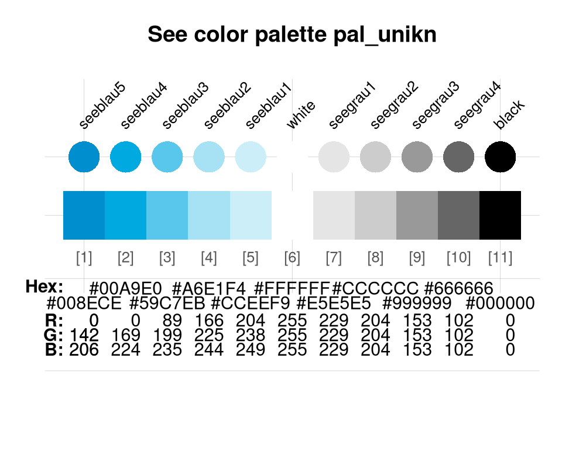

The detailed overview of a color palette provides us with

- the color names (where available),  
- their numeric indices (within the color palette),  
- the HEX values for each color,  
- the RGB values for each color.

When a color palette contains too many colors, the HEX and RGB values
are no longer printed. However, setting `hex` and `rgb` to TRUE will
force them to be shown.

Note that
[`seecol()`](https://hneth.github.io/unikn/reference/seecol.md) also
returns the color palette that is being shown. Thus, a typical workflow
comprises both *seeing* a particular color palette and *saving* it (for
storing and applying it later):

``` r

my_pal <- seecol(pal_unikn_light)  # view details of AND save a color palette  
```

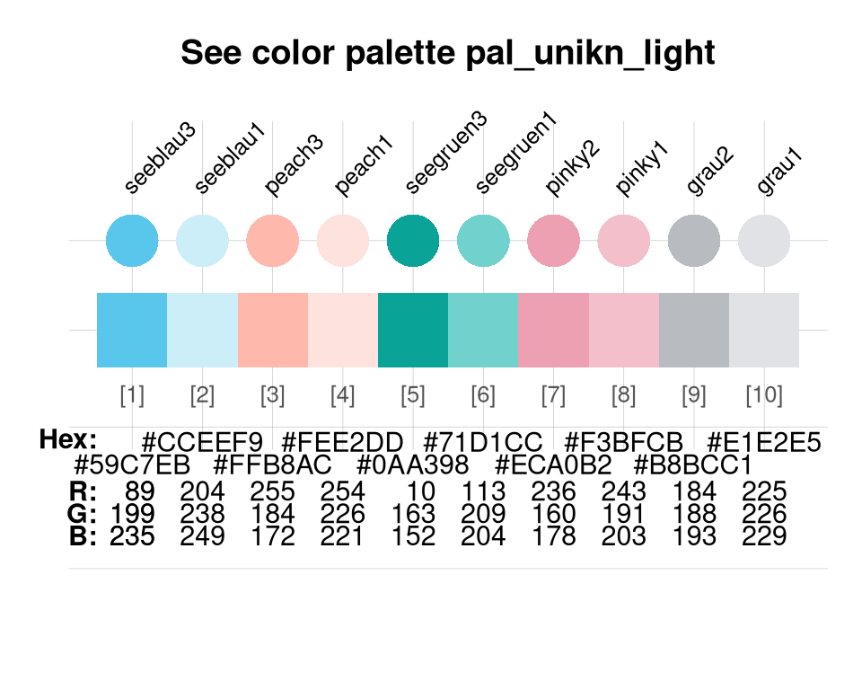

Due to saving the color palette (here to `my_pal`) we can later use it
in a visualization:

``` r

barplot(1/sqrt(1:10), col = my_pal)  # use my_pal in a plot
```

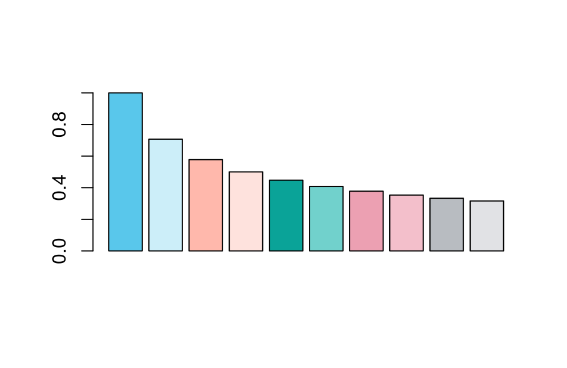

Note that
[`seecol()`](https://hneth.github.io/unikn/reference/seecol.md)
*invisibly* returns the color palette.  
Thus, the following will plot the palette `pal_bordeaux` without doing
anything else with it:

``` r

seecol(pal_bordeaux)
```

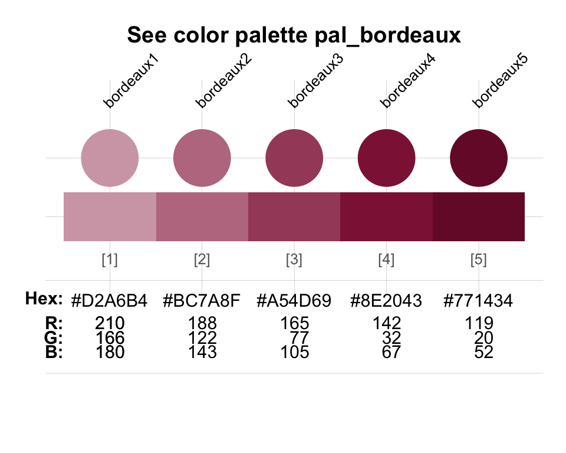

but the following would both plot and assign the palette to `my_pal`:

``` r

my_pal <- seecol(pal_bordeaux)
```

Finally, setting `cube = TRUE` will locate the colors of a palette as
points in a 3D RGB color space (see
[`plot_cube()`](https://hneth.github.io/unikn/reference/plot_cube.md)
for details):

``` r

seecol(pal_unikn_pref, cube = TRUE, main = "A color palette in RGB space")
```

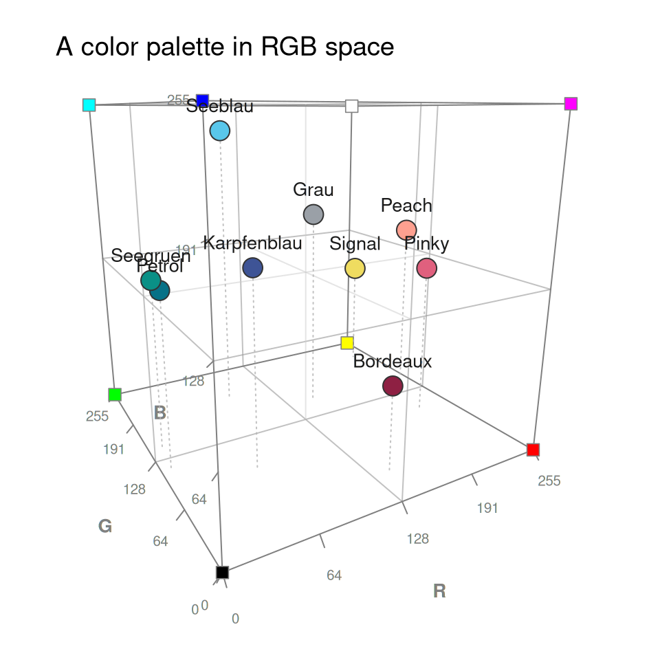

### B. Viewing and comparing multiple color palettes

The second mode of
[`seecol()`](https://hneth.github.io/unikn/reference/seecol.md) is
invoked by providing (a list of) *multiple* color palettes to its `pal`
argument.  
In this case, the function allows comparing these palettes by plotting a
color vector for each palette. Some special keywords within the
**unikn** package denote sets of color palettes:

- The keywords `"unikn_all"`, `"unikn_basic"`, `pair_all"`, `"pref_all"`
  and `"grad_all"` refer to [University of
  Konstanz](https://www.uni-konstanz.de/) color palettes.

Calling `seecol` with `pal` set to these keywords allows comparing
pre-defined sets of the color palettes:

Viewing the [uni.kn](https://www.uni-konstanz.de/) color palettes:

``` r

seecol("unikn_all")  # all uni.kn color palettes
```

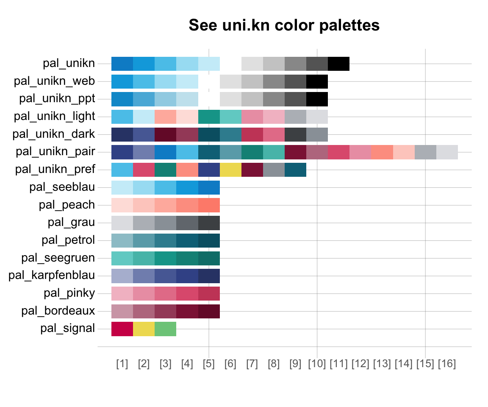

1.  three *basic* color palettes:

``` r

seecol("unikn_basic")
```

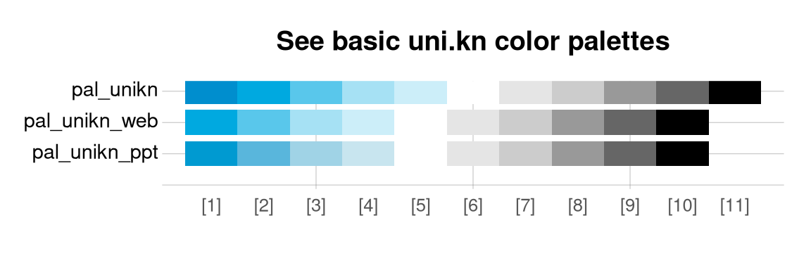

Note, that `pal_unikn_web` and `pal_unikn_ppt` are almost identical, but
differ in how vibrant their colors are.

2.  three *paired* color palettes:

``` r

seecol("pair_all")
```

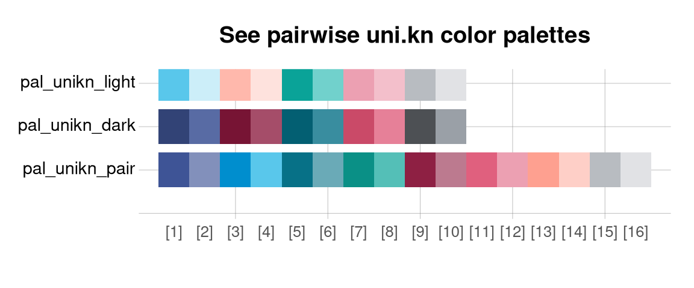

3.  all *preferred* colors from the spectrum and their respective
    *gradients*:

``` r

seecol("pref_all")
```

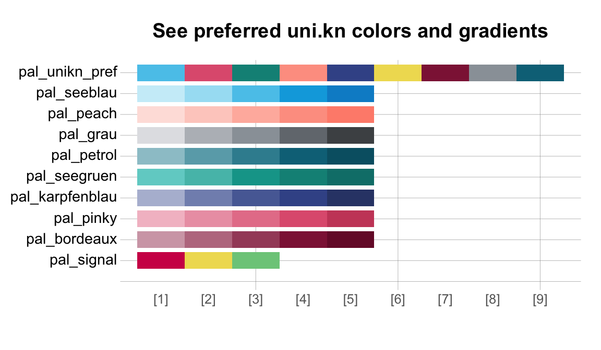

4.  only the pre-defined color *gradients*:

``` r

seecol("grad_all")
```

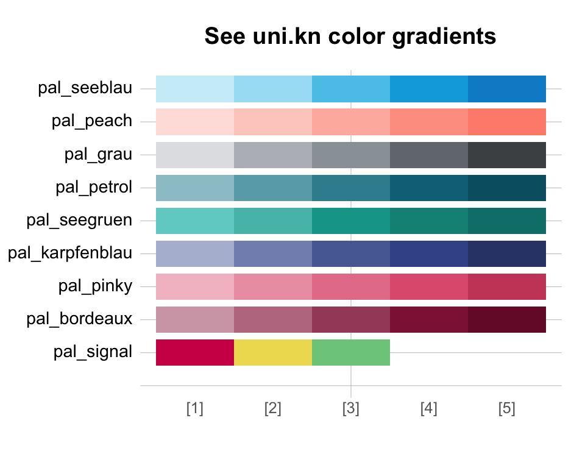

See the vignette on [Institutional
colors](https://hneth.github.io/unikn/articles/inst_colors.md) for
creating color palettes for other institutions.

### Other `seecol()` arguments

The [`seecol()`](https://hneth.github.io/unikn/reference/seecol.md)
function provides some aesthetic parameters for adjusting how color
palettes are plotted:

- `col_brd` allows specifying the color of box borders (if shown.
  Default: `col_brd = NULL`);  
- `lwd_brd` allows specifying the line width of box borders (if shown.
  Default: `lwd_brd = NULL`);  
- `main` and `sub` allow replacing the default titles with custom
  titles.

Examples:

``` r

seecol("grad_all", col_brd = "black", lwd_brd = .5, main = "Color gradients (with black borders)")
```

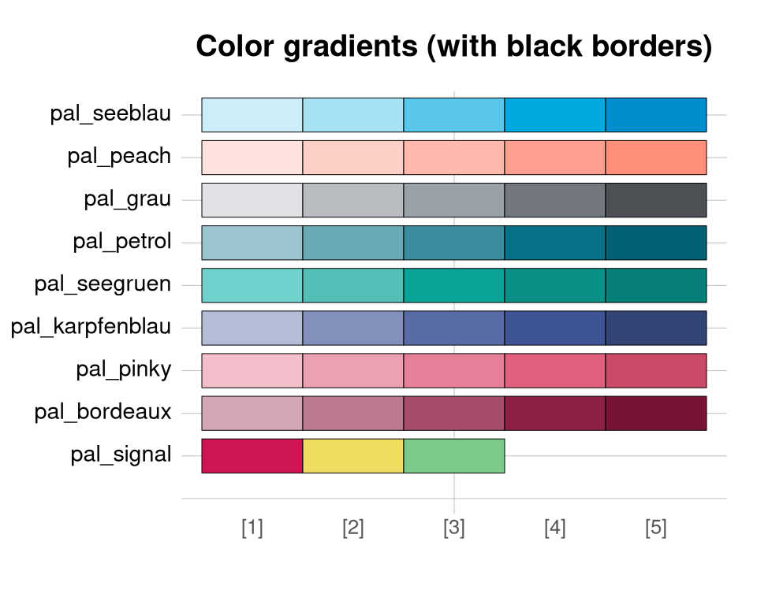

``` r

seecol(pal_seegruen, col_brd = "white", lwd_brd = 5, main = "A color palette (with white borders)")
```

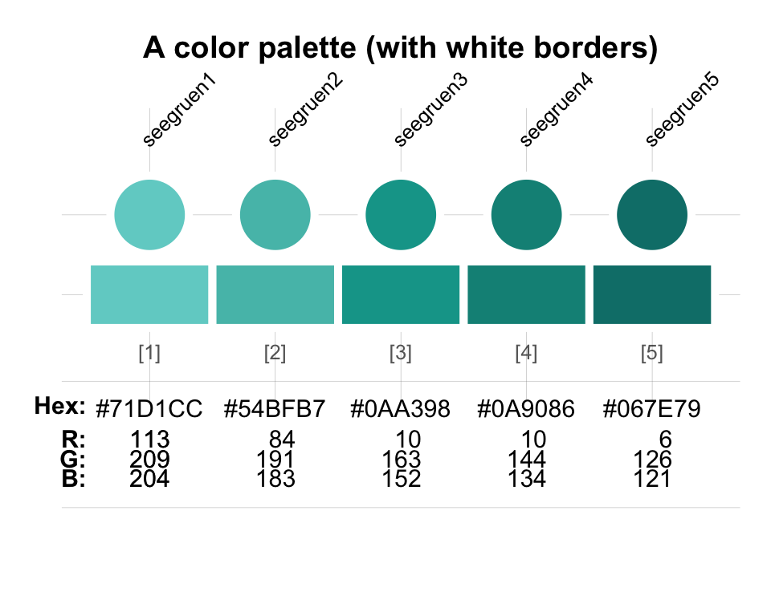

## Using a color palette with `usecol()`

The [`usecol()`](https://hneth.github.io/unikn/reference/usecol.md)
function allows directly using a color palette in a plot (i.e., without
first viewing it).
[`usecol()`](https://hneth.github.io/unikn/reference/usecol.md)
corresponds to
[`seecol()`](https://hneth.github.io/unikn/reference/seecol.md) by
taking the same main arguments (`pal` and `n`). However, as its purpose
is *using* the colors specified by `pal`, rather than plotting (or
*seeing*) them, its `pal` argument typically contains only one color
palette:

``` r

# Using a color palette:
barplot(1/sqrt(1:11), col = usecol(pal_unikn))
```

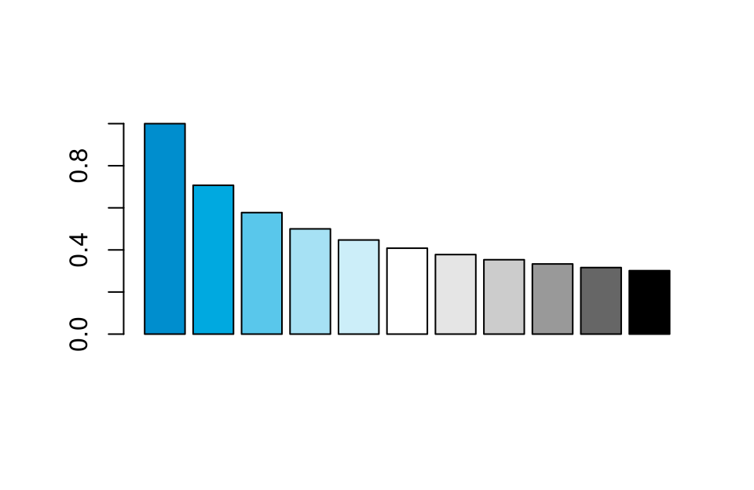

Note that the
[`seecol()`](https://hneth.github.io/unikn/reference/seecol.md) and
[`usecol()`](https://hneth.github.io/unikn/reference/usecol.md)
functions are both quite permissive with respect to specifying their
`pal` argument: A particular color palette (e.g., `pal_seegruen`) can
not only be displayed by providing it (as an object) but also by
providing its name (i.e., `"pal_seegruen"`) or even an incomplete object
name or name (i.e., `"seegruen"` or `seegruen`). Hence, the following
expressions all yield the same result:

``` r

seecol(pal_seegruen)
seecol("pal_seegruen")
seecol("seegruen")
seecol(seegruen)  # issues a warning, but works 
```

## Customizing color palettes

Both the [`seecol()`](https://hneth.github.io/unikn/reference/seecol.md)
and the [`usecol()`](https://hneth.github.io/unikn/reference/usecol.md)
functions allow a flexible on-the-fly customization of color palettes.

Specifying a value for the `n` argument of
[`seecol()`](https://hneth.github.io/unikn/reference/seecol.md) an
[`usecol()`](https://hneth.github.io/unikn/reference/usecol.md) allows:

- specifying subsets of colors and comparing these subsets for different
  palettes for `n` *smaller* than the length of the color palette;  
- extending color palettes and comparing different palettes for `n`
  *greater* than the length of the color palette.

Passing a vector of colors and/or color palettes allows users to create
and view their own color palettes.

Finally, specifying a value for `alpha` (in a range from 0 to 1) allows
controlling the transparency of the color palette(s), with higher values
for `alpha` corresponding to higher transparency (i.e., lower opacity).

### Selecting subsets

Using only a subset of colors:

``` r

seecol("unikn_all", n = 4)
```

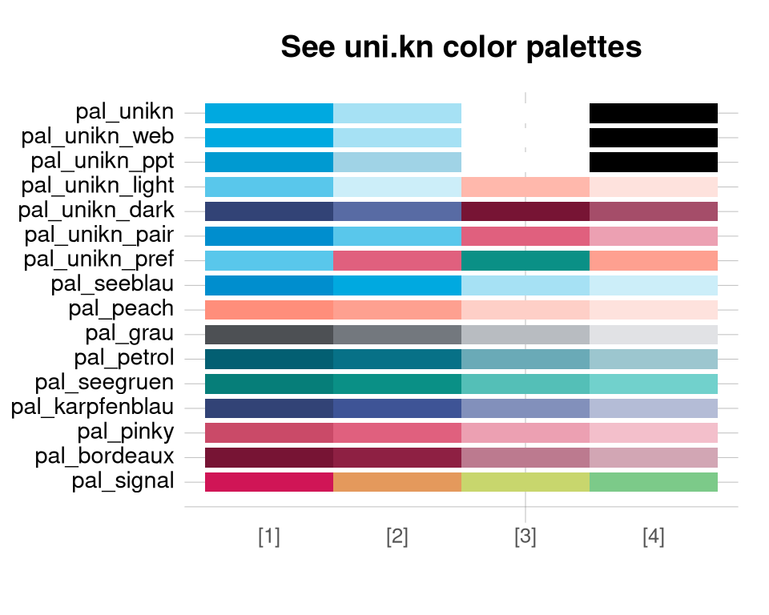

``` r

seecol(pal_unikn, 4)
```

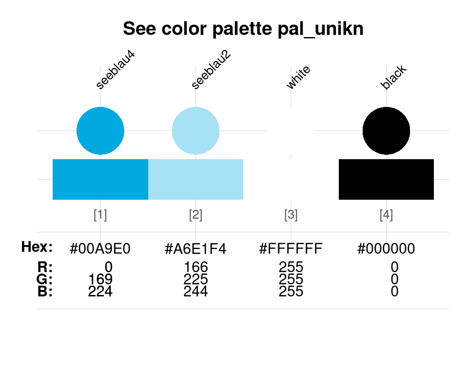

Importantly, when using pre-defined color palettes of **unikn** but a
value of `n` that is smaller than the length of the current color
palette, `usecol` and `seecol` select a predefined subset of colors:

``` r

barplot(1/sqrt(1:2), col = usecol(pal_seeblau, n = 2))
barplot(1/sqrt(1:3), col = usecol(pal_seeblau, n = 3))
```


### Extending color palettes

For values of `n` that are larger than the number of available colors in
`pal`, the specified color palette is extended using `ColorRampPalette`:

``` r

seecol("unikn_all", n = 12)
```

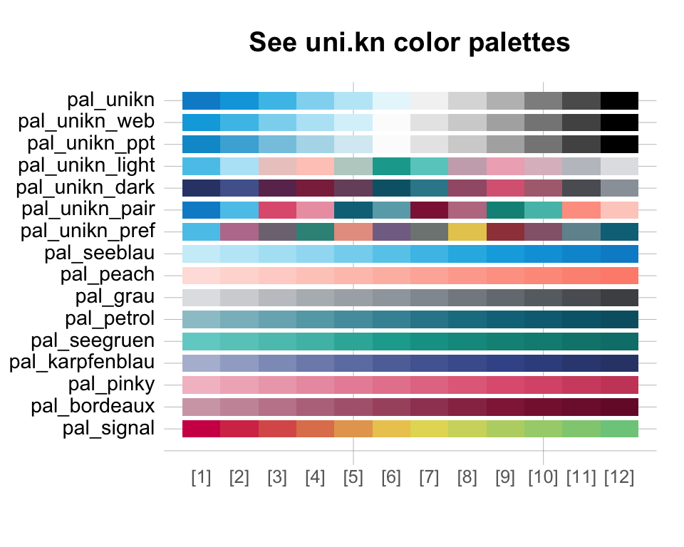

Both [`seecol()`](https://hneth.github.io/unikn/reference/seecol.md) and
[`usecol()`](https://hneth.github.io/unikn/reference/usecol.md) allow
extending or truncating color palettes to a desired number `n` of
colors. For instance:

- Inspecting an extended version of `pal_seeblau` (with `n = 8` colors):

``` r

seecol(pal_seeblau, n = 8)
```

- Using a truncated version of `pal_bordeaux` (with `n = 3` colors):

``` r

barplot(1/sqrt(1:9), col = usecol(pal_bordeaux, n = 3))
```

### Mixing colors and color palettes

By passing a vector to `pal`, we can concatenate 2 color palettes and
connect them with a color (here: `"white"`) as the midpoint of a new
color palette:

``` r

seecol(pal = c(rev(pal_petrol), "white", pal_bordeaux))
```

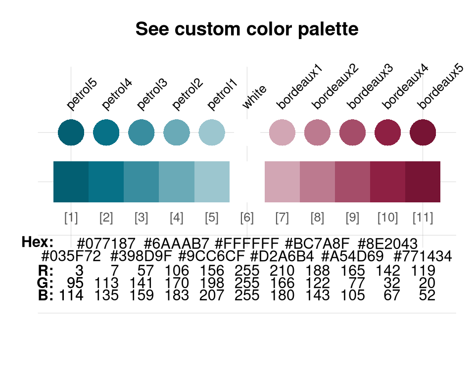

We can combine a set of colors and extend this palette by specifying an
`n` argument that is larger than the length of the specified palette:

``` r

seecol(pal = usecol(c(Karpfenblau, Seeblau, "gold"), n = 10))
```

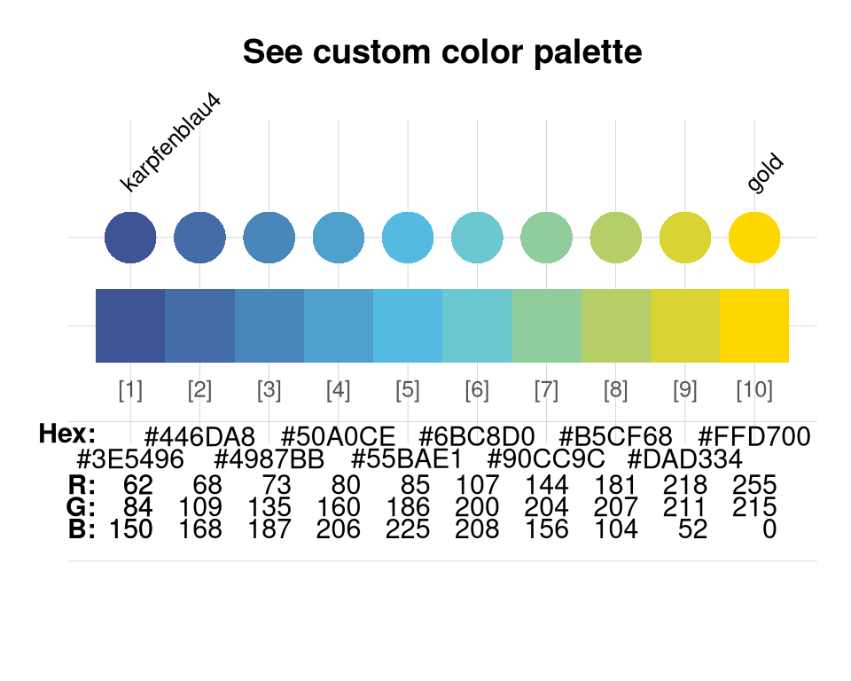

These custom palettes can easily be used in a plot. For instance, we can
define and use a subset of the `pal_unikn_pair` palette as follows:

``` r

my_pair <- seecol(pal_unikn_pair, n = 10)
```

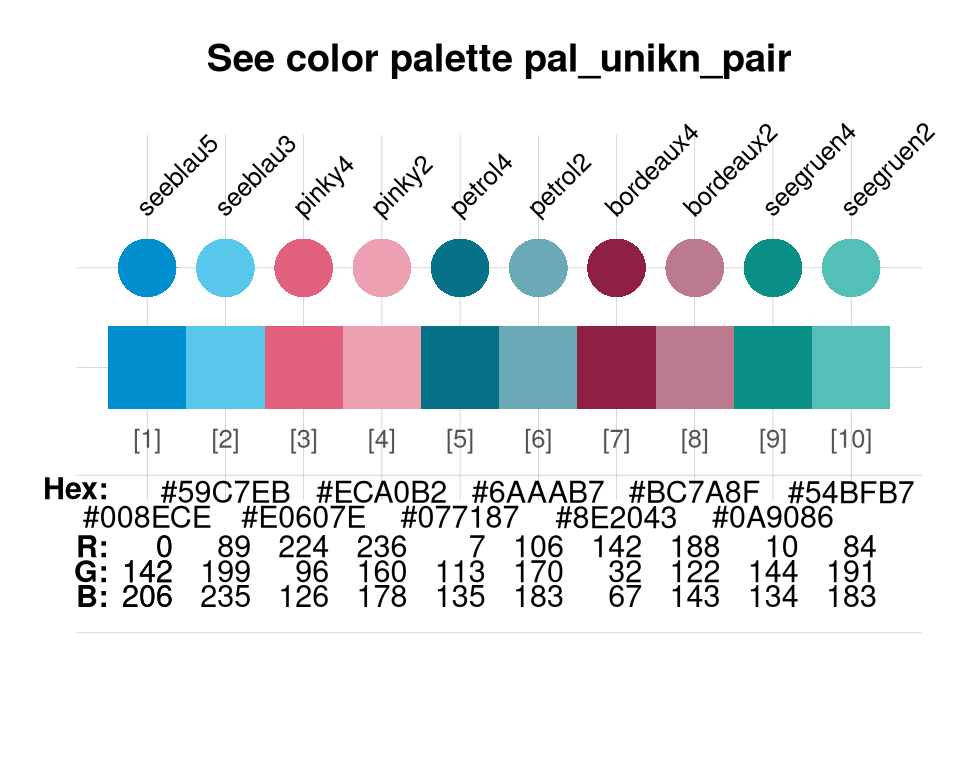

``` r


# Create data: 
dat <- matrix(sample(5:10, size = 10, replace = TRUE), ncol = 5)

# Plot in my_pair colors:
barplot(dat, beside = TRUE, col = my_pair)
```

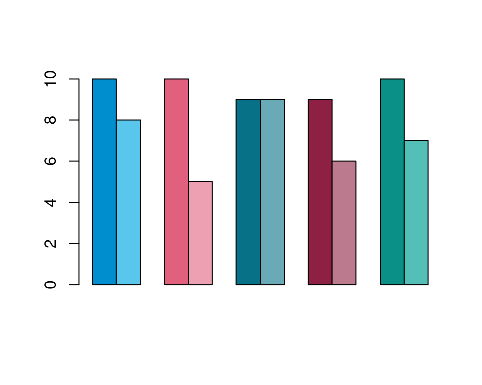

Creating linear color gradients is also supported by the
[`shades_of()`](https://hneth.github.io/unikn/reference/shades_of.md)
function (see below).

### Controlling transparency

Both [`seecol()`](https://hneth.github.io/unikn/reference/seecol.md) and
[`usecol()`](https://hneth.github.io/unikn/reference/usecol.md) accept
an `alpha` argument (in a range from 0 to 1) for controlling the
transparency of color palettes, with higher values for `alpha`
corresponding to lower transparency (i.e., higher opacity).

Displaying a specific color palette at a medium opacity/transparency:

``` r

seecol(pal_unikn, alpha = 0.5)
```

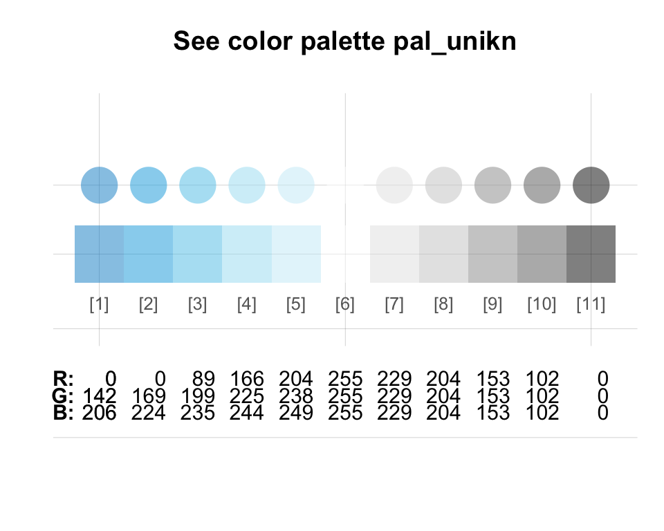

Setting opacity for a custom color palette:

``` r

four_cols <- usecol(c("steelblue", "gold", "firebrick", "forestgreen"), alpha = 2/3)

seecol(four_cols, main = "Four named colors with added transparency")
```

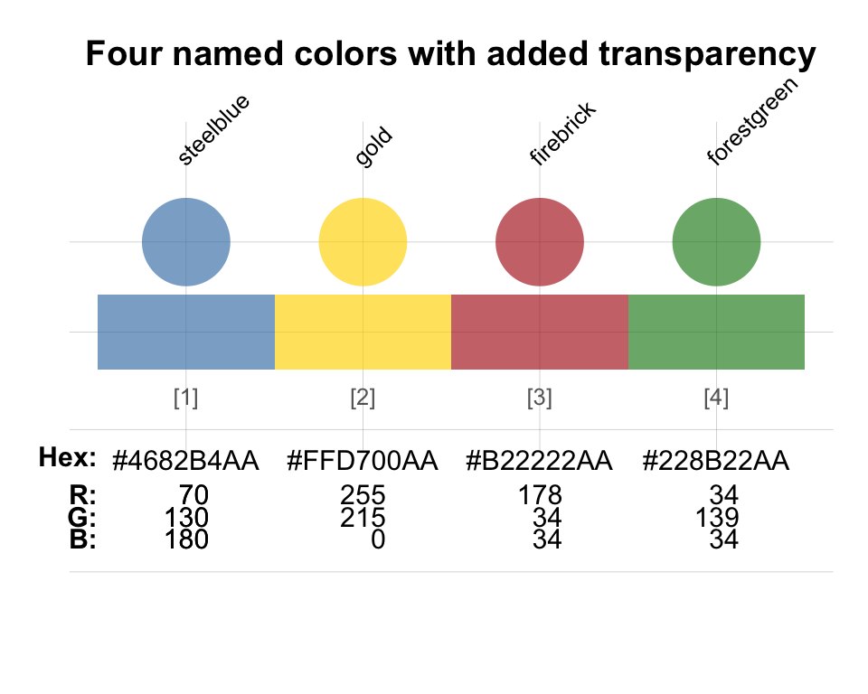

Setting opacity for comparing of multiple color palettes:

``` r

seecol("grad", alpha = 0.67, main = "Seeing transparent color palettes")
```

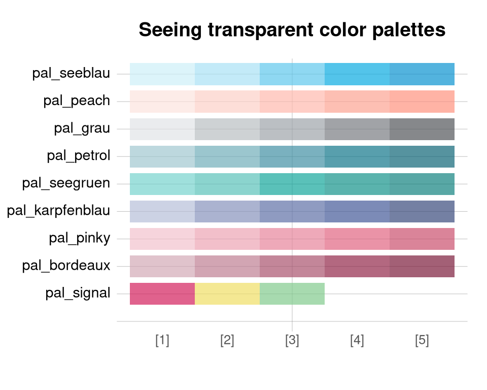

### Creating and comparing custom palettes

Suppose we want to compare a newly created color palette to existing
color palettes. To achieve this, advanced users can use the
[`seecol()`](https://hneth.github.io/unikn/reference/seecol.md) function
for displaying and comparing different custom palettes. When provided
with a list of color palettes as the input to its `pal` argument,
[`seecol()`](https://hneth.github.io/unikn/reference/seecol.md) will
show a *comparison* of the inputs:

``` r

# Define 2 palettes: 
pal1 <- c(rev(pal_seeblau), "white", pal_bordeaux)
pal2 <- usecol(c(Karpfenblau, Seeblau, "gold"), n = 10)

# Show the my_pair palette from above, the 2 palettes just defined, and 2 pre-defined palettes:  
seecol(list(my_pair, pal1, pal2, pal_unikn, pal_unikn_pair))
```

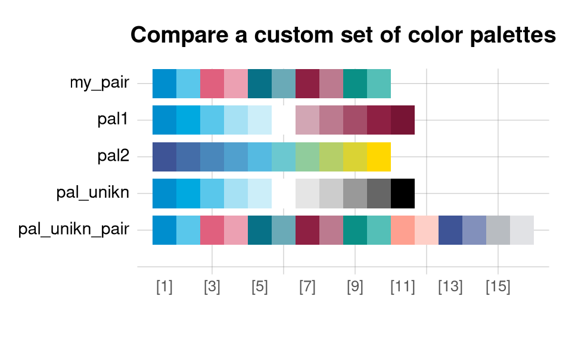

Note that unknown color palettes are named `pal_`$`n`$, in increasing
order. Palettes known to
[`seecol()`](https://hneth.github.io/unikn/reference/seecol.md) are
labeled by their respective names. Labeling only custom palettes works
by setting the `pal_names` argument to a character vector of appropriate
length:

``` r

seecol(list(my_pair, pal1, pal2, pal_unikn, pal_unikn_pair), 
       pal_names = c("my_pair", "blue_bord", "blue_yell"),
       main = "Labeling custom color palettes")
```

If the `pal_names` argument is specified and corresponds to the length
of *all* color palettes, the default names of all color palettes are
overwritten by `pal_names`:

``` r

seecol(list(my_pair, pal1, pal2, pal_unikn, pal_unikn_pair), 
       pal_names = c("my_pair", "blue_bord", "blue_yell", "blue_black", "mix_pair"),
       main = "Comparing and labeling custom color palettes")
```

As before, we can use lower values of `n` for truncating/obtaining
shorter subsets of color palettes:

``` r

seecol(list(my_pair, pal1, pal2, pal_unikn, pal_unikn_pair), n = 5)
```

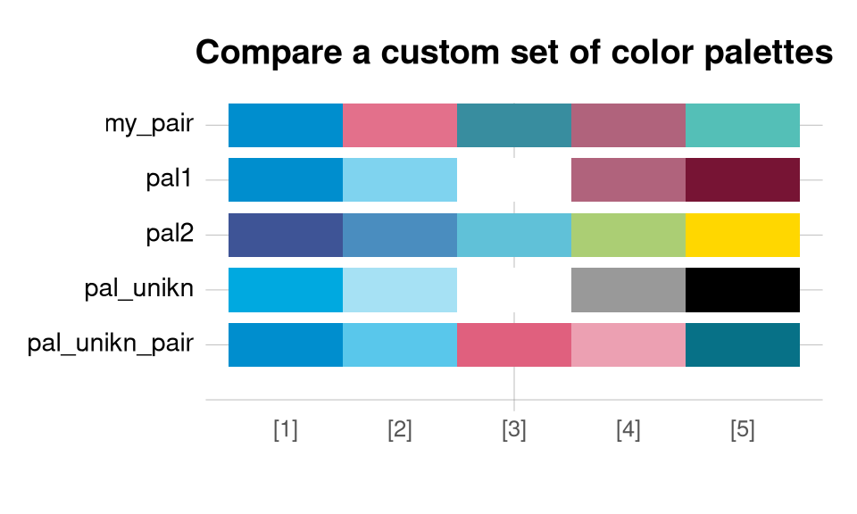

or higher values of `n` for extending color palettes:

``` r

seecol(list(my_pair, pal1, pal2, pal_unikn, pal_unikn_pair), n = 15)
```

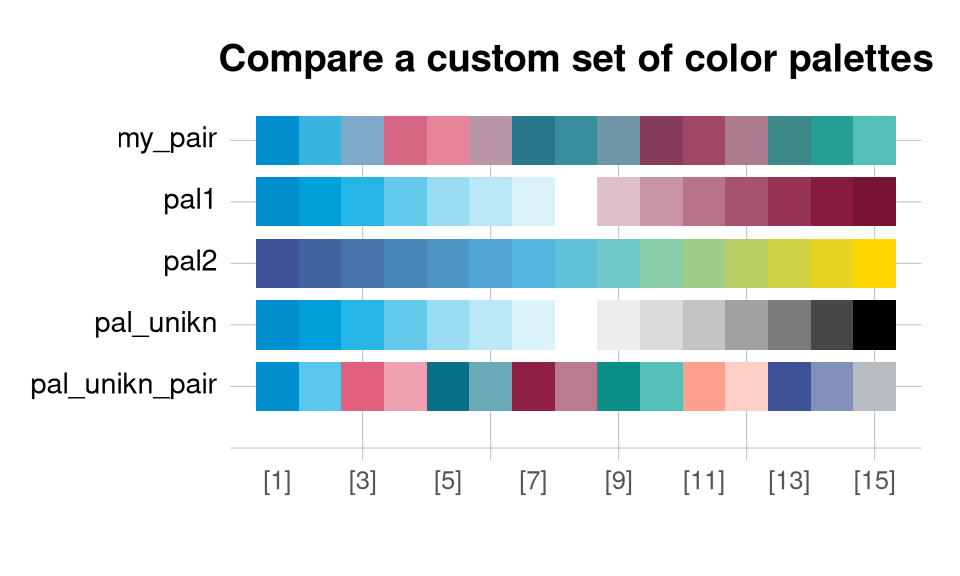

## Finding colors

Two familiar color search tasks are addressed by the
[`simcol()`](https://hneth.github.io/unikn/reference/simcol.md) and
[`grepal()`](https://hneth.github.io/unikn/reference/grepal.md)
functions:

- [`simcol()`](https://hneth.github.io/unikn/reference/simcol.md) allows
  searching for colors that are similar to a given target color
- [`grepal()`](https://hneth.github.io/unikn/reference/grepal.md) allows
  searching for colors whose names match some pattern

### Finding similar colors with `simcol()`

Assuming that our favorite color is `"deeppink"`, a good question is:
How can we find similar colors? Given some target color, the
[`simcol()`](https://hneth.github.io/unikn/reference/simcol.md) function
searches through a set of colors to find and return visually similar
ones:

``` r

simcol("deeppink", plot = FALSE)
#>     deeppink    deeppink2      maroon1      maroon2   violetred1   violetred2 
#>   "deeppink"  "deeppink2"    "maroon1"    "maroon2" "violetred1" "violetred2"
```

By default,
[`simcol()`](https://hneth.github.io/unikn/reference/simcol.md) searches
though all named R colors of
[`colors()`](https://rdrr.io/r/grDevices/colors.html) (of the
**grDevices** package), but adjusting the `col_candidates` and `tol`
arguments allows for more fine-grained searches:

``` r

simcol("deepskyblue", col_candidates = pal_seeblau, tol = c(50, 50, 100))
#>   deepskyblue      seeblau3      seeblau4      seeblau5 
#> "deepskyblue"     "#59C7EB"     "#00A9E0"     "#008ECE"
```

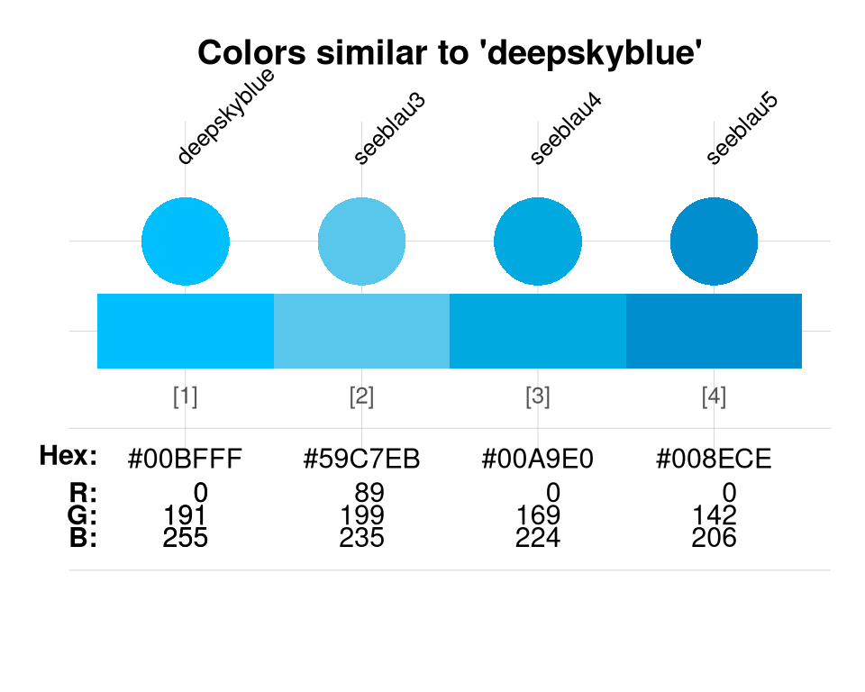

### Finding color names with `grepal()`

We often search for some particular color hue (e.g., some sort of
purple), but also know that the particular color named “purple” is *not*
the one we want. Instead, we would like to see all colors that contain
the keyword “purple” in its name. The
[`grepal()`](https://hneth.github.io/unikn/reference/grepal.md) function
addresses this need:

``` r

grepal("purple")  # get & see 10 names of colors() with "purple" in their name
```

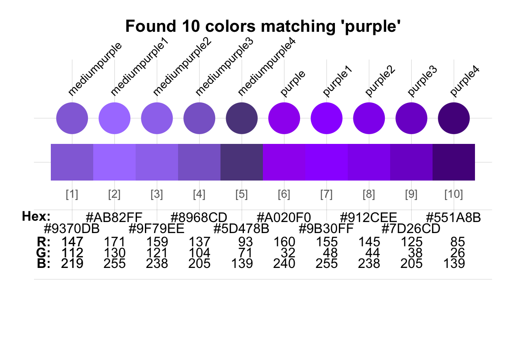

    #>  [1] "mediumpurple"  "mediumpurple1" "mediumpurple2" "mediumpurple3"
    #>  [5] "mediumpurple4" "purple"        "purple1"       "purple2"      
    #>  [9] "purple3"       "purple4"

Note that the
[`grepal()`](https://hneth.github.io/unikn/reference/grepal.md) function
allows searching color names by regular expressions:

``` r

length(grepal("gr(a|e)y", plot = FALSE))    # shades of "gray" or "grey"
#> [1] 224
length(grepal("^gr(a|e)y", plot = FALSE))   # shades starting with "gray" or "grey"
#> [1] 204
length(grepal("^gr(a|e)y$", plot = FALSE))  # shades starting and ending with "gray" or "grey"
#> [1] 2
```

By default,
[`grepal()`](https://hneth.github.io/unikn/reference/grepal.md) searches
the vector of named colors `x = colors()` (of the **grDevices** package)
and plots its results (as a side effect). However, it also allows for
searching color palettes provided as data frames (with color names) and
for suppressing the visualization (by setting `plot = FALSE`):

``` r

grepal("see", pal_unikn)   # finding "see" in (the names of) pal_unikn (as df)
```

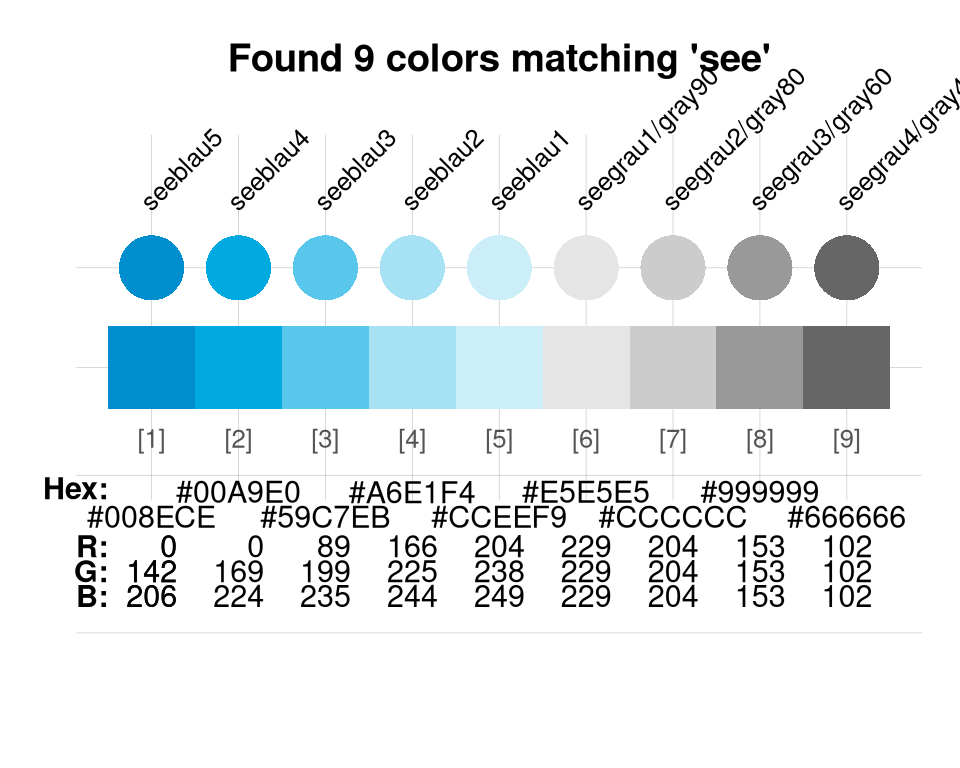

    #>   seeblau5 seeblau4 seeblau3 seeblau2 seeblau1 seegrau1 seegrau2 seegrau3
    #> 1  #008ECE  #00A9E0  #59C7EB  #A6E1F4  #CCEEF9  #E5E5E5  #CCCCCC  #999999
    #>   seegrau4
    #> 1  #666666
    grepal("blau", pal_unikn_pref, plot = FALSE)  # finding "blau" in pal_unikn_pref
    #>   Seeblau Karpfenblau
    #> 1 #59C7EB     #3E5496

## Auxiliary color functions

### Adjusting transparency with `ac()`

The [`ac()`](https://hneth.github.io/unikn/reference/ac.md) function
provides a flexible wrapper around the
[`adjustcolor()`](https://rdrr.io/r/grDevices/adjustcolor.html) function
of the **grDevices** package. Its key functionality is that it allows
for *vectorized* `col` and `alpha` arguments:

``` r

my_cols <- c("black", "firebrick", "forestgreen", "gold", "steelblue")
seecol(ac(my_cols, alpha = c(rep(.25, 5), rep(.75, 5))))
```

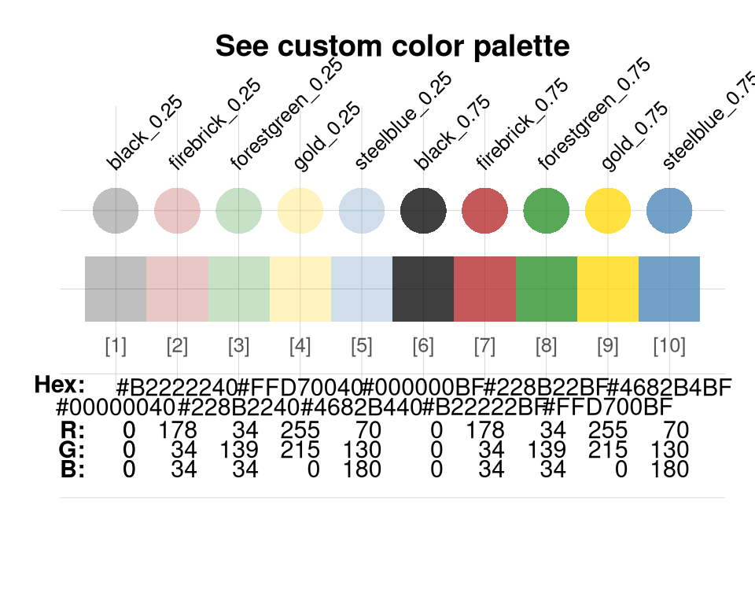

The name `ac` is an abbreviation of “adjust color”, but also a mnemonic
aid for providing “air conditioning”.

### Creating color gradients with `shades_of()`

We have seen that the main
[`usecol()`](https://hneth.github.io/unikn/reference/usecol.md) function
allows stretching and squeezing color palettes and thus creating complex
color gradients. An even simpler way for creating linear color gradients
is provided by the
[`shades_of()`](https://hneth.github.io/unikn/reference/shades_of.md)
function:

``` r

seecol(shades_of(n = 5, col_1 = Karpfenblau), main = "5 shades of Karpfenblau")
```

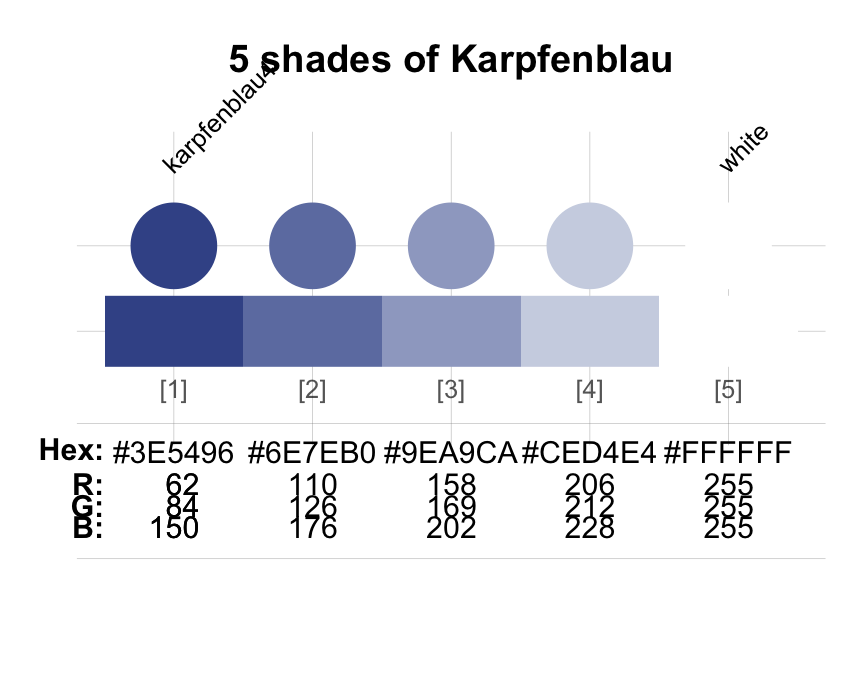

Internally,
[`shades_of()`](https://hneth.github.io/unikn/reference/shades_of.md) is
just a convenient wrapper for a special
[`usecol()`](https://hneth.github.io/unikn/reference/usecol.md)
function. The limitation of
[`shades_of()`](https://hneth.github.io/unikn/reference/shades_of.md) is
that it only allows creating bi-polar color palettes (i.e., gradients
between two colors). When the final color `col_n` is unspecified, its
default of “white” is used (as in the example). By contrast, the
[`usecol()`](https://hneth.github.io/unikn/reference/usecol.md) function
allows creating color gradients between an arbitrary number of colors.
Thus, the following two expressions define the same bi-polar color
palette:

``` r

pg_1 <- usecol(c("deeppink", "gold"), 5)
pg_2 <- shades_of(5, "deeppink", "gold")
all.equal(pg_1, pg_2)
#> [1] TRUE

seecol(pg_2, main = "A bi-polar color gradient")
```

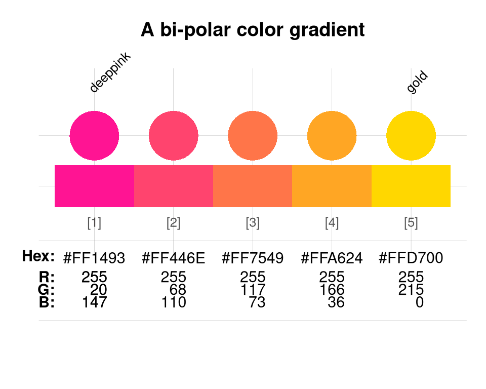

### Defining color palettes with `newpal()`

Having created, combined or found all those beautiful colors, we may
wish to define a new color palette. Defining a new named color palette
allows to consistently access and apply colors (e.g., to a series of
visualizations in a report or publication). The
[`newpal()`](https://hneth.github.io/unikn/reference/newpal.md) function
makes it easy to define color palettes:

``` r

col_flag <- c("#000000", "#dd0000", "#ffce00")  # source: www.schemecolor.com

flag_de  <- newpal(col = col_flag,
                   names = c("black", "red", "gold"))

seecol(flag_de, main = "Defining a flag_de color palette")
```

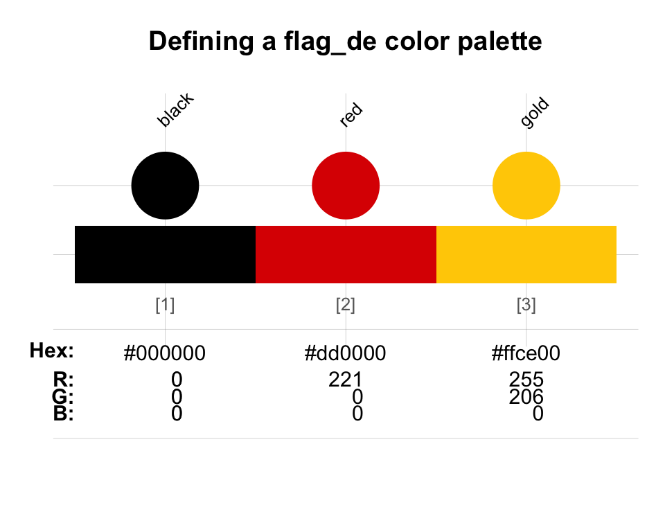

By default,
[`newpal()`](https://hneth.github.io/unikn/reference/newpal.md) returns
the new color palette as a (named) vector. Setting `as_df = TRUE`
returns a data frame.

### Illustrating color palettes with `demopal()`

After choosing, creating or modifying a color palette, we usually
inspect the result with
[`seecol()`](https://hneth.github.io/unikn/reference/seecol.md).
Alternatively, we can use the
[`demopal()`](https://hneth.github.io/unikn/reference/demopal.md)
function to use a color palette `pal` in a visualization. Currently, the
`type` argument supports the following visualizations:

1.  “bar”: A bar plot
2.  “curve”: A plot of normal distribution curves (with transparency)
3.  “mosaic”: A mosaic/table plot
4.  “polygon”: An area/polygon plot
5.  “scatter”: A scatter plot of points (with transparency)

All types of
[`demopal()`](https://hneth.github.io/unikn/reference/demopal.md)
invisibly return their (randomly generated) data and accept some
graphical arguments (e.g., `col_par` and `alpha`), a scaling `n` and a
`seed` value (for reproducible results), as well as `main` and `sub`
arguments (for setting plot titles). Some functions additionally accept
type-specific arguments (e.g., logical `beside`, `horiz`, and `as_prop`
arguments for plot `type = "bar"`).

``` r

demopal(pal = pg_2, type = 3)
```

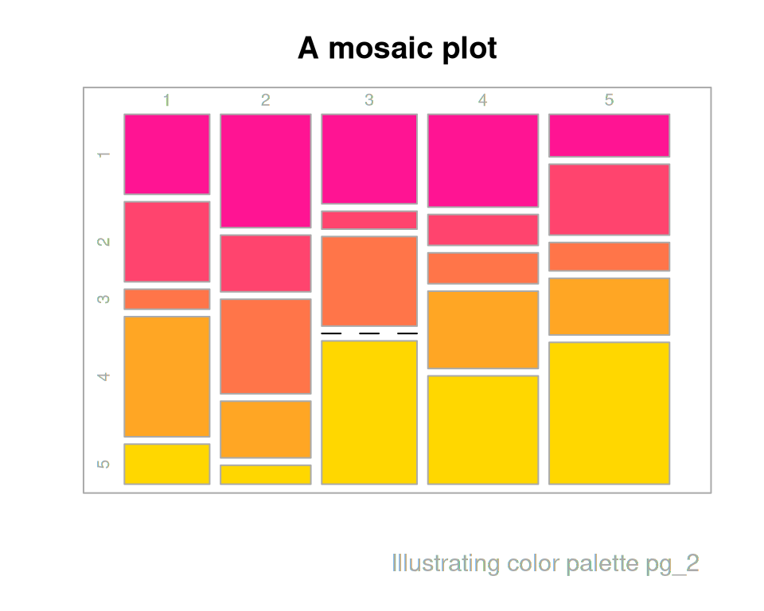

This concludes our quick tour through the colors and color functions of
the **unikn** package. We hope that they enable you to find, design, and
use beautiful color palettes — and spice up your visualizations by vivid
and flamboyant colors!

## Resources

The following versions of **unikn** and corresponding resources are
currently available:

| Type: | Version: | URL: |
|:---|:---|:---|
| A. **unikn** (R package): | [Release version](https://CRAN.R-project.org/package=unikn) | <https://CRAN.R-project.org/package=unikn> |
|   | [Development version](https://github.com/hneth/unikn/) | <https://github.com/hneth/unikn/> |
| B. Online documentation: | [Release version](https://hneth.github.io/unikn/) | <https://hneth.github.io/unikn/> |
|   | [Development version](https://hneth.github.io/unikn/dev/) | <https://hneth.github.io/unikn/dev/> |

## Vignettes

The following vignettes provide instructions and examples for using the
**unikn** colors, color palettes, and functions:

[](https://CRAN.R-project.org/package=unikn)

| Nr. | Vignette | Content |
|---:|:---|:---|
| 1\. | [Colors](https://hneth.github.io/unikn/articles/color_functions.md) | Colors and color functions |
| 2\. | [Color recipes](https://hneth.github.io/unikn/articles/color_recipes.md) | Recipes for color-related tasks |
| 3\. | [Institutional colors](https://hneth.github.io/unikn/articles/inst_colors.md) | Creating color palettes for other institutions |
| 4\. | [Text](https://hneth.github.io/unikn/articles/text_decorations.md) | Text boxes and decorations |
