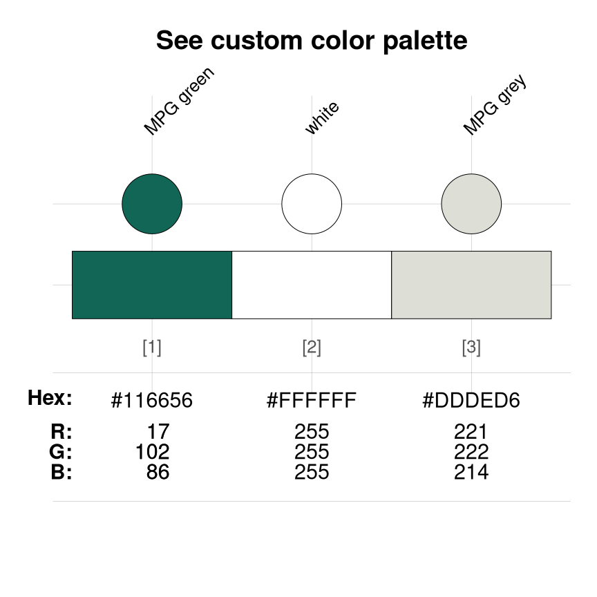
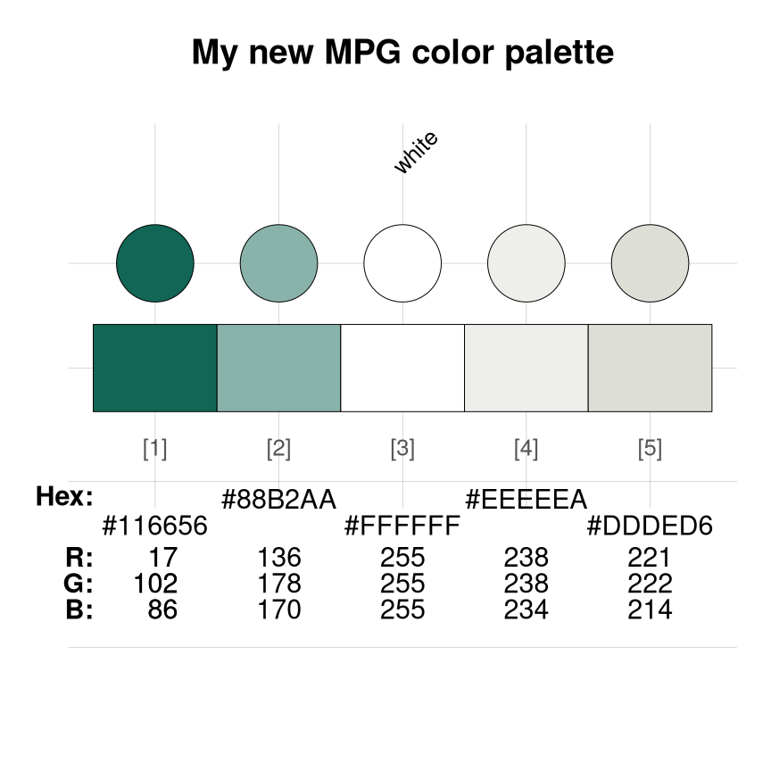
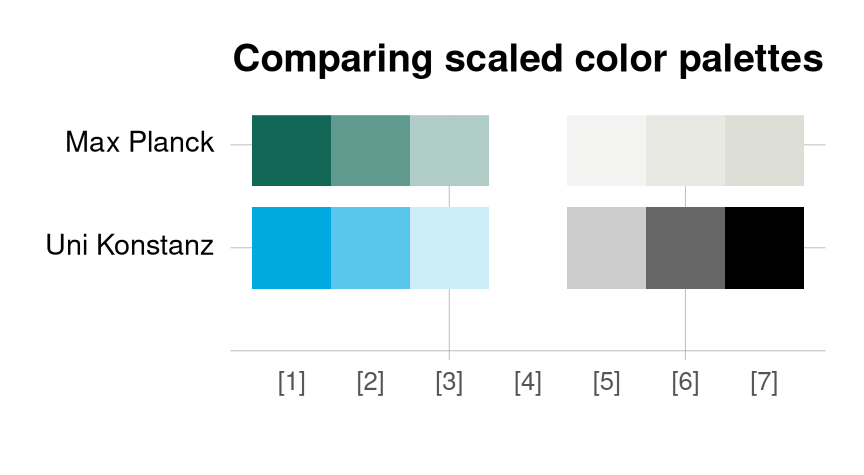

# Institutional colors

[](https://CRAN.R-project.org/package=unikn)

The color palettes included in the **unikn** package are based on the
CD manual of the [University of Konstanz](https://www.uni-konstanz.de/).
However, the functionality provided by the package makes it easy and
straightforward to define and use **your own colors**.

Version 0.8.0 of **unikn** (released in 2023-01-06) contained
52 additional color palettes from other institutions (mostly
universities).

As the number of color palettes has been growing beyond the scope of
this package, the color palettes from other institutions are now being
collected in a separate R package
**[unicol](https://CRAN.R-project.org/package=unicol)**.

Installing **[unicol](https://CRAN.R-project.org/package=unicol)**
currently provides access to a diverse range of over **200 color
palettes** from over **80 institutions**.

[](https://CRAN.R-project.org/package=unicol)

The rest of this vignette explains how the color-related tools of
**unikn** can be used for **creating new color palettes**. If you do so,
please consider submitting it to be included in future versions of the
**[unicol](https://CRAN.R-project.org/package=unicol)** package. (For a
general introduction of the **unikn** colors, color palettes, and color
functions, see the vignettes on [Colors and color
functions](https://hneth.github.io/unikn/articles/color_functions.md)
and [Color
recipes](https://hneth.github.io/unikn/articles/color_recipes.md). The
vignette on [Text boxes and
decorations](https://hneth.github.io/unikn/articles/text_decorations.md)
provides information on plotting slides and text elements.)

We install or load the **unikn** package to get started:

``` r

# install.packages('unikn')  # install unikn from CRAN client
library('unikn')             # load the package
```

## Creating new color palettes

A color palette is an ordered collection of color objects. Creating new
color palettes in R is simple and only requires two steps:

1.  Define the palette’s elementary colors as R objects.

2.  Combine colors into a color palette.

In the following, we illustrate both steps. As we will see, Step 1 can
either be omitted (when the to-be-combined colors exist as R objects) or
can be included in Step 2.

As an example, we will re-create the color palette of the German [Max
Planck Society](https://www.mpg.de/en) (which **unikn** used to export
as `mpg_pal`, but see `mpg` of the **unicol** package) from the color
definitions in its Corporate Design manual (available
[here](https://ppbwiki.fhi.mpg.de/files/home/MPG_Corporate_Design_Manual.pdf)).

### 1. Defining colors

Before we can a create new color palette in R, its elementary colors
need to exist as R objects. (If all colors to-be-combined into a new
palette exist as R objects, we can skip this step and directly proceed
to **2. Combining colors into a palette**.) Defining new colors in R
requires a basic understanding of their underlying representation.

How colors are represented and perceived is a wide-ranging topic that
has fascinated scholars and practitioners for centuries. Essentially,
there are many alternative ways to analyze or synthesize colors, and the
most appropriate representational way depends on the specific context of
a particular use case (see [Wikipedia: Color
model](https://en.wikipedia.org/wiki/Color_model) for an introduction).

In R, the **grDevices** package (included in any default installation)
provides colors and color-related functions. Although R supports many
color models (including HCL, HSV, Lab, Luv, and RGB variants), the three
most common ways of expressing colors in R are:

1.  by R color name: R includes 657 named colors, whose names are
    provided (as a character vector) by evaluating the
    [`colors()`](https://rdrr.io/r/grDevices/colors.html) function of
    **grDevices**.

2.  by RGB values: Every color (or hue) is expressed by a triple of
    numeric values on three dimensions that denote the additive primary
    colors (red, green, blue). The range of values is either expressed
    on a scale from 0 to 1, or — more typically — on a scale from 0
    to 255 (i.e., on an 8 bit scale allowing for $`2^8 = 256`$ different
    values).

3.  by HEX values: Every color (or hue) is expressed by a character
    string (with the prefix `#`), followed by a triple of hexadecimal
    values (each ranging from `00` to `FF`) that correspond to the
    triple of decimal RGB values (in the range from 0 to 255).

Importantly, the *same* color (or hue) can be denoted by its name, its
RGB values, and its HEX values. Thus, the three different systems (i.e.,
color name, RGB values, or HEX values) can be *alternative*
representations of the same object. However, just as the properties of
an alphabet or numeral notation system constraints the words or numbers
that can be expressed by it, the universe of possible colors is limited
by their representation. For instance, whereas the RGB and HEX systems
usually distinguish between more than 16 million (i.e.,
$`(2^8)^3 = 256^3 = 16.777.216`$) possible colors, only a limited number
of them are named. Similarly, when multiple names refer to the same
triple of RGB or HEX values, they denote the same color.[^1]

An example helps clarifying these abstract terms. When viewing an
existing color or color palette with the
[`seecol()`](https://hneth.github.io/unikn/reference/seecol.md) function
of **unikn**, the name, HEX and RGB values of the individual colors are
being shown. For instance, the following color palette `mpg_pal`
provides the colors of the [Max Planck Society](https://www.mpg.de/en):



As the middle color of `mpg_pal` is one of the 657 named colors of
[`colors()`](https://rdrr.io/r/grDevices/colors.html), R will recognize
it as a color when we type its name (as a character object `"white"`) in
a context that expects color inputs. However, the two other colors of
`mpg_pal` have specifically been defined by the [Max Planck
Society](https://www.mpg.de/en) and thus are *not* pre-defined colors of
R (i.e., not contained in
[`colors()`](https://rdrr.io/r/grDevices/colors.html)). To use such
colors in R, we first need to define them as color objects.

So how can we define new colors in R? Most institutions will provide
definitions of their corporate colors or instructions how they can be
defined in some standard color system. Unfortunately, some definitions
(such as those using the subtractive CMYK model) are aimed at printing
(as opposed to computer screens) and other standards (such as numeric
PANTONE™ PMS codes) are proprietary. But as most institutions have an
interest in widely disseminating their colors, they typically include
translations or approximations for alternative color models in their
definitions.

[](https://www.mpg.de/en)

The [Max Planck Society](https://www.mpg.de/en) defines two main colors
in its CD manual (available
[here](https://ppbwiki.fhi.mpg.de/files/home/MPG_Corporate_Design_Manual.pdf)):

- A dark shade of green is defined as Pantone 328, and approximated by
  CMYK 100/0/57/30 or RGB 17/102/86.

- A light shade of grey is Pantone 427, and approximated by
  CMYK 0/0/6/15 or RGB 221/222/214.

In the following, we will first use the RGB values to define both colors
(as these are provided in the definition). However, we then show that we
alternatively could have used the colors’ HEX values (had they been
provided) to define the same color objects.

#### Defining colors from their RGB values

As our two colors of interest are given in RGB values, we can use the
[`rgb()`](https://rdrr.io/r/grDevices/rgb.html) function of the
**grDevices** package to define corresponding objects:

``` r

mpg_green <- grDevices::rgb( 17, 102,  86, maxColorValue = 255)
mpg_grey  <- grDevices::rgb(221, 222, 214, maxColorValue = 255)
```

The first three arguments specify values on the `red`, `green`, and
`blue` dimension, respectively. Importantly, the values must be in the
range $`[0, max]`$, where $`max`$ is provided by `maxColorValue = 255`.
Whereas the [sRGB standard](https://en.wikipedia.org/wiki/SRGB)
expresses all values in a normalized range of $`[0, 1]`$, most color
definitions use the traditional 8-bit representation that distinguish
between $`2^8 = 256`$ levels in the range $`[0, 255]`$. The
[`rgb()`](https://rdrr.io/r/grDevices/rgb.html) function additionally
allows for adding `names` and a transparency level `alpha`, but as we
can modify these aspects later, we do not need to use them at this
point.

What do we obtain when we evaluate our new color objects? Let’s see:

``` r

mpg_green
#> [1] "#116656"
mpg_grey
#> [1] "#DDDED6"
```

When evaluating an object created by
[`rgb()`](https://rdrr.io/r/grDevices/rgb.html), R returns a character
sequence of the form `"#rrggbb"`. In this string, the sequence `rrggbb`
expresses the three RGB values (for the `red`, `green`, and `blue`
dimension, respectively) in hexadecimal (HEX) notation (in the range
$`[0, 255]`$). In HEX notation, the ten numeral symbols (i.e., the
digits from 0 to 9) or the decimal system are extended by the first six
letters of the alphabet (i.e., A to F) to turn our familiar base-10
notation into an analogous place-value notation with a base of 16. Thus,
the HEX values of `"#116656"` is merely a more compact way of expressing

- `red`: $`1 \cdot 16 + 1 = 17`$
- `green`: $`6 \cdot 16 + 6 = 102`$
- `blue`: $`5 \cdot 16 + 6 = 86`$

Thus, the HEX values `"#116656"` provide an alternative way of
expressing the RGB values 17/102/86 — and both refer to the color “MPG
green” (shown as `mpg_pal[1]` above).

#### Defining colors from their HEX values

The equivalence of the RGB and HEX notations can be illustrated by
defining the same colors a second time, but this time specifying their
HEX values (returned above):

``` r

mpg_green_2 <- "#116656"
mpg_grey_2  <- "#DDDED6"
```

If both definitions really yield identical R objects, the following
checks must evaluate to `TRUE`:

``` r

all.equal(mpg_green, mpg_green_2)
#> [1] TRUE
all.equal(mpg_grey,  mpg_grey_2)
#> [1] TRUE
```

Thus, we can define colors from both their RGB or HEX values — and the
two notations are really just two alternative ways of representing the
same colors.

### 2. Combining colors into a palette

Having defined two new colors, we can easily combine them into a new
color palette. A *color palette* is simply a sequence of colors that are
stored in some sequential data structure. The two simplest data
structures in R that are suited for this purpose are vectors or data
frames. Thus, the following two expressions both define valid color
palettes:

``` r

c(mpg_green, mpg_grey)
#> [1] "#116656" "#DDDED6"
data.frame(mpg_green, mpg_grey)
#>   mpg_green mpg_grey
#> 1   #116656  #DDDED6
```

As it often is easier to remember and access colors by their names, it
usually makes sense to name the elements of a color palette (e.g., by
using the `name()` function).

The [`newpal()`](https://hneth.github.io/unikn/reference/newpal.md)
function of **unikn** provides a convenient wrapper for defining color
palettes. Its main argument `col` uses a vector of color objects that
make up the new palette, whereas `names` and `as_df` allow specifying
color names and switching between returning the new palette as a vector
or data base.  
Importantly, the color objects of `col` can be provided as RGB values,
as R color names, or as HEX values:

``` r

mpg_pal_3 <- newpal(col = c(rgb( 17, 102,  86, maxColorValue = 255), "white", "#DDDED6"),
                    names = c("MPG green", "white", "MPG grey"),
                    as_df = FALSE)
```

The new color palette `mpg_pal_3` contains the three basic colors of
`mpg_pal` (shown above):

``` r

seecol(mpg_pal_3, 
       main = "My new color palette", col_brd = "black", lwd_brd = .5)
```


The 5-color palette provided as `mpg_pal` includes two intermediate
colors (at positions `mpg_pal[2]` and `mpg_pal[4]`) that are
extrapolated by mixing the two main MPG colors with “white” in a
balanced (50:50) fashion. The
[`usecol()`](https://hneth.github.io/unikn/reference/usecol.md) function
of **unikn** automatically performs these extrapolations when extending
a 3-element color palette (e.g., `mpg_pal_3`) to `n = 5` colors:

``` r

my_mpg_pal <- usecol(mpg_pal_3, n = 5)
```

The resulting color palette `my_mpg_pal` recreates the colors of the
**unikn** color palette `mpg_pal` (shown above):

``` r

seecol(my_mpg_pal, main = "My new MPG color palette", 
       col_brd = "black", lwd_brd = .5)
```



Technically, the two color palettes differ in some names and the way in
which its middle color (“white”) was specified (by its R color name or
HEX values). However, when using
[`col2rgb()`](https://rdrr.io/r/grDevices/col2rgb.html) for converting
both palettes into their RGB values, we see that they contain the same
colors:

``` r

all.equal(col2rgb(mpg_pal), col2rgb(my_mpg_pal), check.attributes = FALSE)
#> [1] "Numeric: lengths (9, 15) differ"
```

This concludes our illustration of defining a new colors and color
palettes.

## Comparing color palettes

Once a new palette has been defined (and is available in your current R
environment), the
[`seecol()`](https://hneth.github.io/unikn/reference/seecol.md) and
[`usecol()`](https://hneth.github.io/unikn/reference/usecol.md)
functions allow comparing, scaling, and using them in the same fashion
as the native **unikn** color palettes:

``` r

# Scaled palettes: 
seecol(list(mpg_pal, pal_unikn), n = 7,
       pal_names = c("Max Planck", "Uni Konstanz"),
       main = "Comparing scaled color palettes")
```



See the vignette on [Color
recipes](https://hneth.github.io/unikn/articles/color_recipes.md) for
additional examples of using **unikn** functions for solving
color-related tasks.

## Call for contributions

We are still expanding the range of color palettes from other
institutions in a dedicated R package
**[unicol](https://github.com/hneth/unicol)**.

**Collecting color palettes**

[](https://CRAN.R-project.org/package=unicol)

- Are you using the **unikn** color functions to create **your own color
  palettes**?

If so, please **let us know** (e.g., by posting on this [GitHub
issue](https://github.com/hneth/unicol/issues/30))!

We collect color palettes from other institutions to make them available
to R users in future versions of
**[unicol](https://github.com/hneth/unicol)**.

To enable us to verify and provide credit to your contributions, please
send us the following information:

1.  your code (e.g., the
    [`newpal()`](https://hneth.github.io/unikn/reference/newpal.md)
    command creating your color palette),  
2.  your reference or source information (e.g., some URL with color
    definitions),  
3.  your name and some contact information (e.g., an Email address).

We’re looking forward to your inputs and contributions (at this [GitHub
issue](https://github.com/hneth/unicol/issues/30))!

## Resources

The following versions of **unikn** and corresponding resources are
currently available:

| Type: | Version: | URL: |
|:---|:---|:---|
| A. **unikn** (R package): | [Release version](https://CRAN.R-project.org/package=unikn) | <https://CRAN.R-project.org/package=unikn> |
|   | [Development version](https://github.com/hneth/unikn/) | <https://github.com/hneth/unikn/> |
| B. Online documentation: | [Release version](https://hneth.github.io/unikn/) | <https://hneth.github.io/unikn/> |
|   | [Development version](https://hneth.github.io/unikn/dev/) | <https://hneth.github.io/unikn/dev/> |

## Vignettes

The following vignettes provide instructions and examples for using the
**unikn** colors, color palettes, and functions:

[](https://CRAN.R-project.org/package=unikn)

| Nr. | Vignette | Content |
|---:|:---|:---|
| 1\. | [Colors](https://hneth.github.io/unikn/articles/color_functions.md) | Colors and color functions |
| 2\. | [Color recipes](https://hneth.github.io/unikn/articles/color_recipes.md) | Recipes for color-related tasks |
| 3\. | [Institutional colors](https://hneth.github.io/unikn/articles/inst_colors.md) | Creating color palettes for other institutions |
| 4\. | [Text](https://hneth.github.io/unikn/articles/text_decorations.md) | Text boxes and decorations |

[^1]: Strictly speaking, different shades of a given color can be
    further distinguished by different *opacity* or *transparency*
    levels (typically denoted by an `alpha` value). However, the visual
    appearance of a transparent color can be mimicked by mixing the
    color with the background color (usually “white”). Hence,
    transparent shades of a color are usually not counted as different
    colors.
