# Text boxes and decorations

[](https://CRAN.R-project.org/package=unikn)

This vignette explains the **unikn** functions for plotting graphical
elements and text decorations. (See the vignette on
[colors](https://hneth.github.io/unikn/articles/color_functions.md) for
general information on colors, color palettes, and corresponding
functions, or the more specialized vignettes on [color
recipes](https://hneth.github.io/unikn/articles/color_recipes.md) and
[institutional
colors](https://hneth.github.io/unikn/articles/inst_colors.md).)

Please install and/or load the **unikn** package to get started:

``` r

# install.packages('unikn')  # install unikn from CRAN client
library('unikn')             # loads the package
```

## Overview

Beyond providing support for
[colors](https://hneth.github.io/unikn/articles/color_functions.md),
**unikn** provides functions for plotting graphical elements (like
boxes) and text decorations (with colored backgrounds or underlining).
Before illustrating these functions, please note some caveats:

- Plotting text (i.e., graphically rendering characters) is rarely a
  good idea. In contrast to the vector fonts used by DTP programs,
  plotted text typically does not scale (when changing the size of
  images) and cannot be recognized automatically (e.g., copied, indexed,
  or scraped). Hence, the following functions should only be used when
  no better solutions are available (e.g., for adding text to graphs, or
  for obstructing automatic text recognition).

- Like all other templates, our renderings are subject to constraints
  and limitations. For instance, as any standard installation of
  [R](https://www.r-project.org/) lacks the prescribed “Theinhardt”
  fonts, we only mimic the official design specifications (in Arial,
  sans serif).

That said, digital decorations can be useful to emphasize or structure
information, provided that they can be produced easily and flexibly. The
**unikn** package helps preventing common mistakes by novices (e.g.,
boxes or lines extending beyond text, or step-functions in multi-line
headings) and can be customized and improved by expert users. Hence, we
hope that the following functions are useful for plotting graphical
elements (e.g., boxes, logos, etc.) and help you achieve a uniform look
when styling presentations or visualizations.

Please load the **unikn** package to get started:

``` r

library(unikn)  # load unikn package
```

## Plotting empty slides and boxes

As the text functions of **unikn** add styled text to an existing plot,
we must first create a plot to which we can add text. **unikn** provides
2 basic functions for creating new plots:

1.  `slide` plots an empty canvass (a rectangular box or frame);
2.  `xbox` plots a colored box with an X in its top right corner.

Here are both commands with their default settings:

``` r

slide()  # plot default slide
```

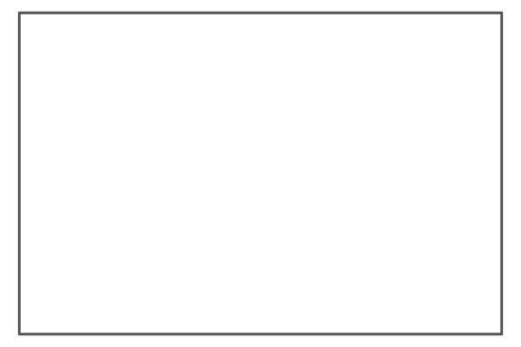

``` r

xbox()  # plot default xbox
```

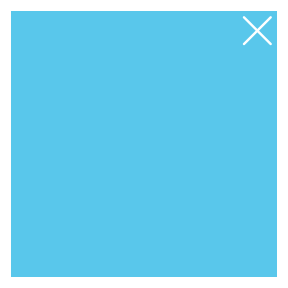

Both functions accept additional arguments to customize their
appearance.

### Colors

The background and border colors of slides can be changed by setting
their `col`, `border`, and `lwd` arguments:

``` r

slide(col = pal_seeblau[[1]], border = Petrol, lwd = 5)  # set colors of slide background and border
```

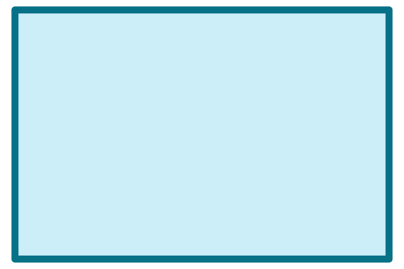

``` r

slide(col = pal_peach[[2]], border = NA)  # colored slide without a border
```

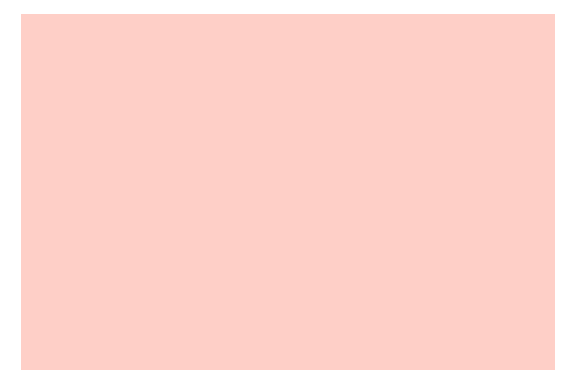

Similarly, the background color of xboxes can be changed by the `col`
argument:

``` r

xbox(col = Pinky)  # set background color of xbox
```

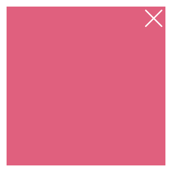

### Dimensions

By default, both `slide` and `xbox` fill the entire plotting region
(i.e., all margins are set to 0).

The width of a slide is set to 4/3 of its height (of 1). To change this
default, use the `dim` argument for specifying the slide’s x- and
y-dimensions, respectively:

``` r

slide(dim = c(3, 1))  # a slide 3x wider than high
```

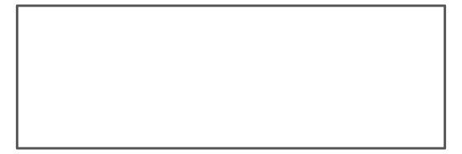

Note that changes in slide dimensions are invisible when viewing images
interactively, as R automatically scales images to the size of the
canvass. They mostly affect the relation between metrics when adding
elements to an object.

Similarly, an xbox has the default dimensions of a unit square (i.e.,
`dim = c(1, 1)`). To change this default, use the `dim` argument for
specifying the xbox’s `x`- and `y`-dimensions, respectively:

``` r

xbox(col = Petrol, dim  = c(1, 2))  # an xbox 2 times higher than wide
```

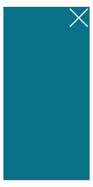

The two strokes of the X (in the top right corner) are orthogonal when
viewing the `xbox` at the aspect ratio indicated by `dim` (i.e., here:
at a ratio of width x = 1 to height y = 2). When viewing the box at any
different aspect ratio, the X appears to be distorted. Hence, viewing
and printing plots at the desired aspect ratio helps when creating an
xbox.

## Plotting styled text

There are three main functions for plotting text with decorations:

- [`mark()`](https://hneth.github.io/unikn/reference/mark.md) allows
  highlighting text with colored background boxes;
- [`uline()`](https://hneth.github.io/unikn/reference/uline.md) allows
  underlining text with colored lines;
- [`post()`](https://hneth.github.io/unikn/reference/post.md) allows
  posting text in rectangular `xbox` elements.

In addition, there are 2 auxiliary functions:

- `headline()` allows plotting headlines with colored background boxes;
- [`url_unikn()`](https://hneth.github.io/unikn/reference/url_unikn.md)
  allows formatting URLs the uni.kn way.

The following sections illustrate the functions and their main options
in turn.

### Mark text

The [`mark()`](https://hneth.github.io/unikn/reference/mark.md) function
allows highlighting text by plotting it with colored background boxes
(to provide the functionality of “Markieren”):

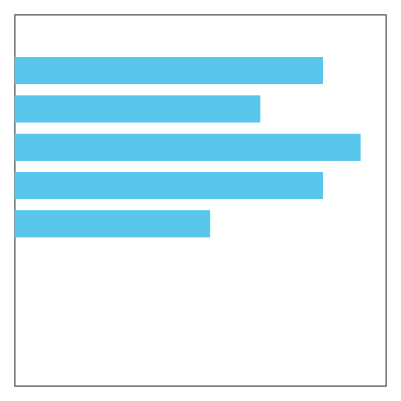

By default, [`mark()`](https://hneth.github.io/unikn/reference/mark.md)
assumes that we want to add highlighted text to an existing plot. The
text labels to be added are provided (as a character vector) by the
`labels` argument, their coordinates as the corresponding `x` and `y`
arguments. Various text decorations (i.e., text and background colors,
text sizes, and font types) can be set by specifying additional
arguments (i.e., `col`, `col_bg`, `cex`, and `font`, respectively):

``` r

# Some pre-existing plot: 
n <- 20
set.seed(1)
par(mar = c(0, 0, 0, 0))
plot(x = runif(n), y = runif(n), type = "p", pch = 16, cex = 20, col = grey(0, .2),
     axes = FALSE, xlab = "", ylab = "")

# Add 1 marked label:
mark(labels = "Some messy plot", x = .02, y = .9)

# Add 2 more marked labels:
mark(labels = c("Note something here.", "More highlighting here."), 
     x = c(.1, .6), y = c(.2, .4),
     col_bg = c(pal_seeblau[[2]], pal_peach[[3]]), cex = 1.2)
```

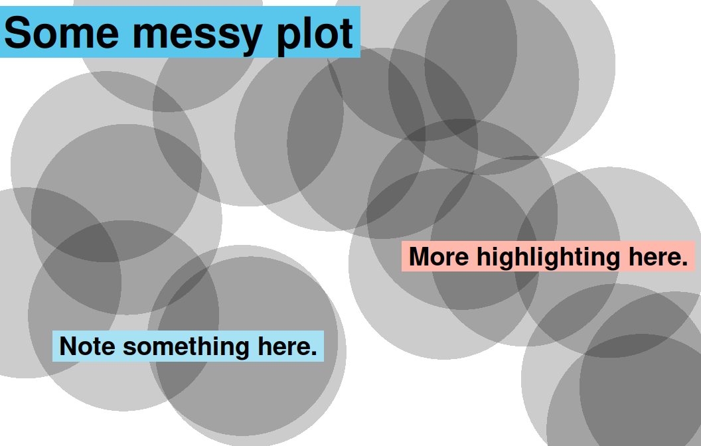

If no pre-existing plot is available, setting the `new_plot` argument to
either `"blank"` or `"slide"` will generate a new default plot (by
calling the
[`slide()`](https://hneth.github.io/unikn/reference/slide.md) function
described above):

``` r

# A sentence to plot: 
s <- c("Markieren",
       "ist ein Bestandteil",
       "von Studieren.")

# Create a new plot (of type "slide"):
mark(labels = s,
     x = 0, y = .85, y_layout = .03,
     col_bg = Seeblau,
     cex = 1.5,
     new_plot = "slide")

# Add text to the same plot:
mark(labels = s,
     x = 0, y = .40, y_layout = .03,
     col_bg = pal_pinky[[2]],
     cex = 1.5, 
     new_plot = "none")
```

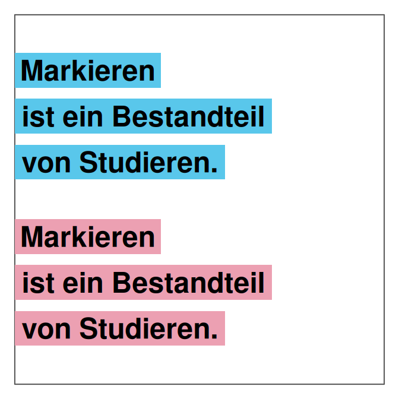

Rather than providing explicit `x` and `y` coordinates for all text
elements in `labels`, the calls above defined an initial coordinate and
used a numeric `y_layout` argument to fix the distance between
consecutive text labels (to a value of `.03`).

As an alternative to numeric coordinates and position values, `x_layout`
and `y_layout` also accept some special values (as character strings):

1.  `x_layout` accepts:

    - `x_layout = "center"` for centering labels horizontally (on the
      first label or the middle),  
    - `x_layout = "left"` left-justifies labels (on the first label or
      the middle), and  
    - `x_layout = "right"` right-justifies labels (on the first label or
      the middle).

2.  `y_layout` accepts:

    - `y_layout = "even"` for an even distribution of labels across the
      available y-space, and  
    - `y_layout = "flush"` to omit space between adjacent labels (as in
      `y_layout = 0`).

Thus, the position and orientation of the text labels can be controlled
by using the `x_layout` and `y_layout` options:

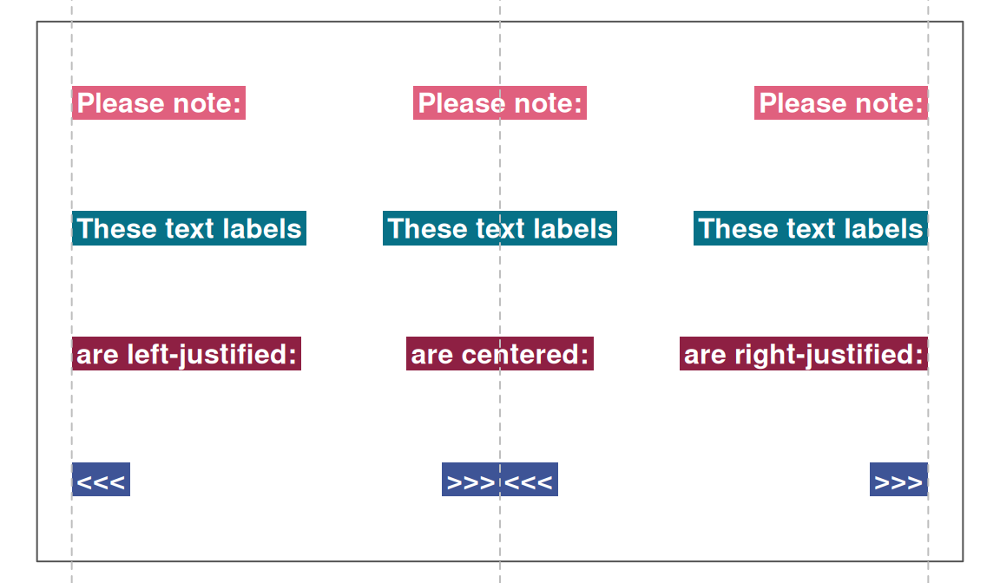

See [`?mark`](https://hneth.github.io/unikn/reference/mark.md) for
details.

### Underline text

The [`uline()`](https://hneth.github.io/unikn/reference/uline.md)
function allows emphasizing text by plotting it with colored underlining
(to provide the functionality of “Unterstreichen”):

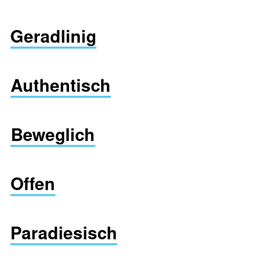

As with [`mark()`](https://hneth.github.io/unikn/reference/mark.md)
above, the [`uline()`](https://hneth.github.io/unikn/reference/uline.md)
command distinguishes between creating a new plot (by setting `new_plot`
to either `"blank"` or “`slide`”) or adding to a pre-existing plot (by
using the default `new_plot = "none"`):

``` r

lbl_uline <- c("This is neat, true, and terribly important")
uline(labels = lbl_uline, new_plot = "blank", y = .6, cex = 1.1)  # create a new plot
uline(labels = "(which is why we underline it).", y = .45, cex = 1)  # add to plot
```

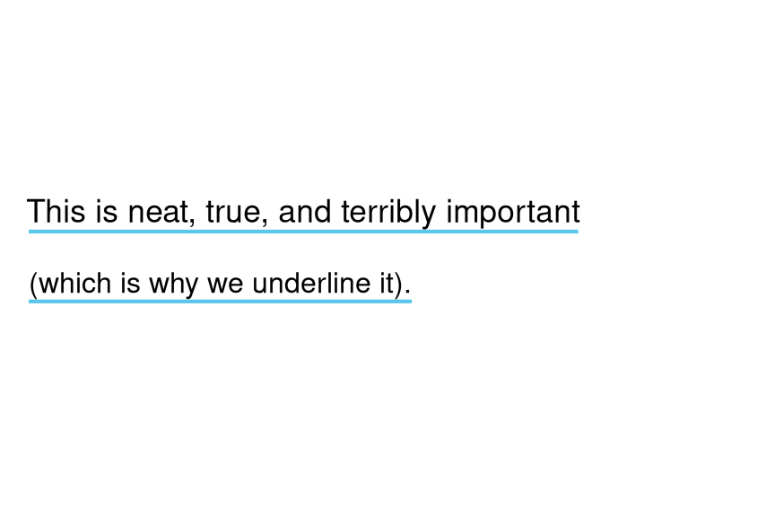

The arguments for text elements (`labels`), text positions (`x`, `y`,
`y_layout`), and text properties and decorations (`col`, `col_bg`,
`cex`, and `font`) work as they do for
[`mark()`](https://hneth.github.io/unikn/reference/mark.md). For
instance, shorter vectors are recycled to match the length of `labels`:

``` r

slogan <- c("Geradlinig", "Farbenfroh", "Beweglich", "Bunt", "Paradiesisch")
uline(labels = slogan,
      x = c(0, .5), y = .9, y_layout = "even",
      col = c("black", Bordeaux), col_bg = c(Seeblau, Seegruen), 
      cex = 1.1, font = 2, new_plot = "blank")
```

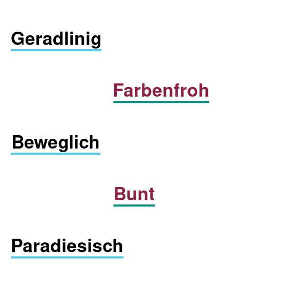

The position and orientation of the text labels can be controlled by
using the `x_layout` and `y_layout` options:

### Post text

The [`post()`](https://hneth.github.io/unikn/reference/post.md) function
allows adding text to a rectangular `xbox` (to provide the functionality
of “Merken”):

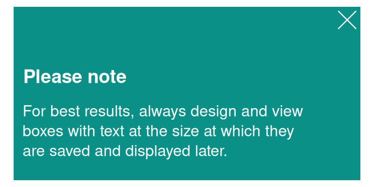

By default, [`post()`](https://hneth.github.io/unikn/reference/post.md)
assumes a pre-existing `xbox` to which the text elements of `labels` are
to be added.  
For square boxes, setting `new_plot` to `"xbox"` creates a new `xbox`
with its default dimensions of `dim = c(1, 1)`.  
By adjusting its color and text arguments,
[`post()`](https://hneth.github.io/unikn/reference/post.md) allows
creating simple badges or logos:

``` r

# Badge (to view as 250 x 250 pixel):
post(labels = "ToDo", y = .35, 
     col = "white", col_bg = pal_signal[[1]],
     cex = 3, font = 2, new_plot = "xbox")  

# Badge (to view as 250 x 250 pixel):
post(labels = "R", y = .35, 
     col = "white", col_bg = pal_seeblau[[5]],
     cex = 8, font = 2, new_plot = "xbox")
```


Another potential use of
[`post()`](https://hneth.github.io/unikn/reference/post.md) is for
creating images providing contact details:

``` r

address <- c("Dr. B. F. Skinner", " ",
             "Department of Psychology",
             "Office Z101",
             "Tel.: +49 7531 88-0815",
             "Fax: +49 7531 88-0810",
             "b.f.skin@uni-konstanz.de")

post(labels = "Contact",
     y = .7,
     cex = 1.2, font = 2,
     col_bg = Petrol,
     new_plot = "xbox")  # create new plot 

post(labels = address,
     y = .5, y_layout = .03,
     new_plot = "none")  # add to plot
```


As above, the position and orientation of the text labels can be
controlled by using the `x_layout` and `y_layout` options:

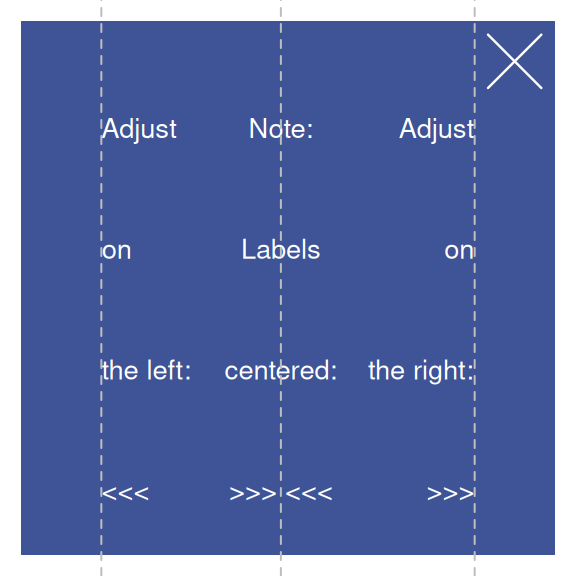

### Headings

The [`heading()`](https://hneth.github.io/unikn/reference/heading.md)
function makes it easy to create recognizable headings:

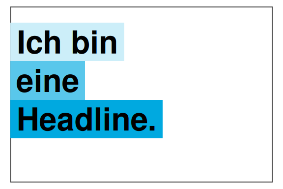

By default, the function creates a new slide (i.e.,
`new_plot = "slide"`) and positions the text elements of `labels` on its
left edge (i.e., `x = 0`, `y = .8` and `y_layout = "flush"`). When
headings violate the official recommendations, a message is provided:

``` r

heading(labels = c("Ewig", "währt am", "längsten..."), 
        y = 2/3, col_bg = usecol(pal_pinky))
```

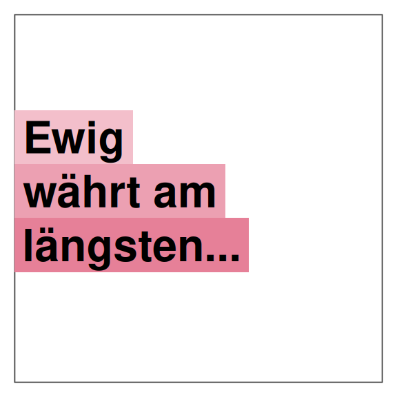

Re-arranging words helps to avoid step-wise titles (see p. 25 of the
CD manual):

``` r

# Beware of step-wise arrangements:
heading(labels = c("Ich", "bin keine", "gute Headline."))
#> Step-wise titles are discouraged: Consider re-arranging?
```

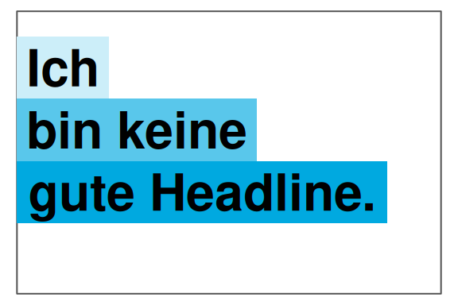

``` r


# Avoiding warning:
heading(labels = c("Ich bin", "eine alternative", "Headline."))
```

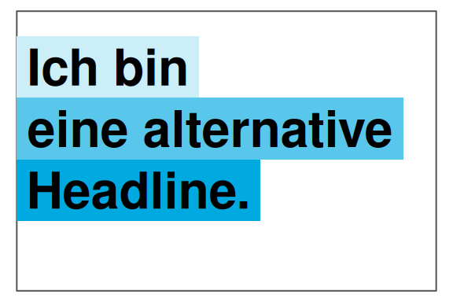

When colors are left unspecified,
[`heading()`](https://hneth.github.io/unikn/reference/heading.md)
selects colors that are appropriate for the number of elements in
`labels` (i.e., shades of `Seeblau` for `col_bg = "default"`). However,
default colors can be overwritten by setting the `col` and `col_bg`
arguments:

``` r

heading(labels = c("Ene,", "mene, miste,", "es rappelt", "in der Kiste."), 
        col = "white", col_bg = c(Pinky, Seegruen, Bordeaux, Karpfenblau))
```

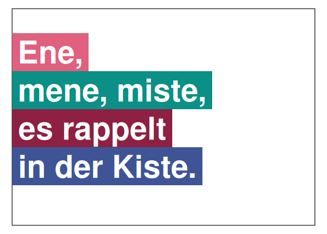

### URLs

One of the more obscure rules (on p. 31 of the CD manual) concerns the
rendering of URLs, in which typical web patterns (like “http” or “www”)
are to be omitted and replaced by a typographical dash (which is longer
than a hyphen). The `url_unikn` utility function allows formatting URLs
the uni.kn way:

``` r

my_url <- url_unikn("https://www.uni-konstanz.de/")  # input URL
my_url # formatted URL
#> [1] "– uni-konstanz.de"

# Put URL at bottom of an xbox:
post(labels = my_url, x = .05, y = .1, font = 4, 
     col_bg = pal_seeblau[[5]], new_plot = "xbox")
```


## Resources

The following versions of **unikn** and corresponding resources are
currently available:

| Type: | Version: | URL: |
|:---|:---|:---|
| A. **unikn** (R package): | [Release version](https://CRAN.R-project.org/package=unikn) | <https://CRAN.R-project.org/package=unikn> |
|   | [Development version](https://github.com/hneth/unikn/) | <https://github.com/hneth/unikn/> |
| B. Online documentation: | [Release version](https://hneth.github.io/unikn/) | <https://hneth.github.io/unikn/> |
|   | [Development version](https://hneth.github.io/unikn/dev/) | <https://hneth.github.io/unikn/dev/> |

## Vignettes

The following vignettes provide instructions and examples for using the
**unikn** colors, color palettes, and functions:

[](https://CRAN.R-project.org/package=unikn)

| Nr. | Vignette | Content |
|---:|:---|:---|
| 1\. | [Colors](https://hneth.github.io/unikn/articles/color_functions.md) | Colors and color functions |
| 2\. | [Color recipes](https://hneth.github.io/unikn/articles/color_recipes.md) | Recipes for color-related tasks |
| 3\. | [Institutional colors](https://hneth.github.io/unikn/articles/inst_colors.md) | Creating color palettes for other institutions |
| 4\. | [Text](https://hneth.github.io/unikn/articles/text_decorations.md) | Text boxes and decorations |
